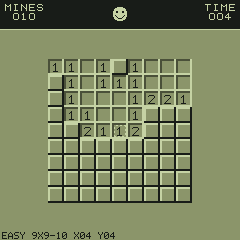

# Minesweeper

> **Demonstration project** — provided as an example of what the PixelRoot32
> Game Engine can do. It is not a product: parts may be incomplete,
> experimental, or deliberately simplified to keep one idea in focus.

Retro Minesweeper on a 240×240 display: difficulty menu, cursor-driven board,
first-click safety, flood reveal, flagging, mine counter, timer, and
win/lose screens — drawn entirely with `Renderer` primitives, no sprites,
no tilemap, no asset headers. The single idea it is about is the
**engine-free rules core**: `Minefield` and `GameSession` never include an
engine, SDL2 or Arduino header, so the same logic compiles for the host
unit tests (`pio test -e host_test`) and for both targets unchanged.

Language: C++17  
Engine: `gperez88/PixelRoot32-Game-Engine@^1.9.0`  
Environments: `native`, `esp32dev`, `host_test`  
Category: Games



## Requirements (build flags)

Set in [`lib/platformio.ini`](lib/platformio.ini)'s `[base]` template, so
every environment inherits them:

- **`PIXELROOT32_ENABLE_AUDIO=1`** — required. Reveal/flag cues, the loss
  blast and the win jingle go through `AudioEngine` / `MusicPlayer`.
  Building without it is not a compile error — it is silence.
- **`PIXELROOT32_ENABLE_PHYSICS=0`** — the board is a fixed `Cell[480]`
  array and every rule is an array lookup. There is nothing to simulate.
- **`PIXELROOT32_ENABLE_PARTICLES=0`** — not used.
- **`PIXELROOT32_ENABLE_UI_SYSTEM=0`** — menu, HUD and result banner are
  `Renderer` text and rectangles, not UI widgets.

Display size is **240×240** in the project `platformio.ini` (see
`PHYSICAL_DISPLAY_*`). The cell size adapts per difficulty so the whole
board always fits: EASY 9×9 → 21 px, MEDIUM 16×16 → 12 px,
EXPERT 30×16 → 8 px, centred under a 44 px HUD.

## Platforms

| Environment | Display | Audio backend |
|-------------|---------|----------------|
| **`native`** | SDL2, 240×240 | `SDL2_AudioBackend` in [`src/platforms/native.h`](src/platforms/native.h) |
| **`esp32dev`** | **ST7789** 240×240 | `ESP32_I2S_AudioBackend` in [`src/platforms/esp32_dev.h`](src/platforms/esp32_dev.h) |
| **`host_test`** | none (rules core only) | none |

Pin choices (ST7789 SPI, I2S audio, D-pad + two buttons) are in
`src/platforms/esp32_dev.h` — edit there if your wiring differs.

## Controls

| Action | `native` (keyboard) | `esp32dev` (GPIO) |
|--------|----------------------|--------------------|
| Move cursor | Arrow keys (hold to auto-repeat) | D-pad (hold to auto-repeat) |
| Open cell | Space | Button A |
| Flag / unflag | Return | Button B |
| Change difficulty (menu) | Up/Down or Left/Right | D-pad, then A to start |
| Back to menu (in game) | Space + Return together | A + B together |
| Retry (game over) | Space | Button A |
| Menu (game over) | Return (or Space + Return) | Button B (or A + B) |

The first opened cell is always safe: mines are placed around it. After a
game ends, input is ignored for 600 ms so the press that ended the game
cannot immediately restart it.

## What it demonstrates

- **Engine-free rules core.** `src/game/Minefield.{h,cpp}` owns cells,
  mine sampling (partial Fisher–Yates over eligible cells, xorshift32 with
  an explicit seed) and the iterative flood over a preallocated 480-slot
  buffer — no recursion, no heap, no per-frame allocation. `src/game/`
  includes nothing but `<cstdint>`, so `host_test` compiles it with no
  display and no SDL2.
- **Deferred first-move safety.** `GameSession` clears the board on `start()`
  but mines it on the first `reveal()`, excluding that cell. Flagging first
  still starts the clock without mining, so the guarantee holds either way.
- **Monotonic clock injection.** The session never reads wall time: the
  scene passes `millis()` in, which freezes the timer on win/lose for free
  and makes every timing test deterministic.
- **Shaped input without an input queue.** `src/input/InputController`
  turns a raw held-button mask into commands: directions auto-repeat after
  350 ms every 120 ms, while reveal/flag/cancel fire on fresh edges only,
  so a held action button cannot open or flag twice. The A+B chord emits
  `Cancel` once per combined press and swallows the individual edges, so
  asking for the menu can never detonate a cell.
- **Deterministic rendering.** The scene reads the session read-only;
  `draw()` never mutates game state. Covered tiles, digits in classic
  colours, flags, exposed mines and the detonated cell are rectangles,
  circles and 5×7 text; `Color::Black` is never used for anything that
  must stay visible (on ESP32 it is the transparent index).
- **Spec deviations, documented.** The spec's `RevealSolver` lives inside
  `Minefield::reveal()` rather than as its own file, and the
  renderer/HUD are private helpers of `MinesweeperScene` (the tic-tac-toe
  convention) instead of separate classes — same responsibilities, fewer
  files. Best times are RAM-only (persistent records are spec P2 and out
  of scope for this demo).

## Project layout

```
src/
├── GameConstants.h        HUD geometry, adaptive cell size, lockout timing
├── game/
│   ├── MinefieldConfig.h  difficulties, Cell/BoardConfig, capacity limits
│   ├── Minefield.h/.cpp   board storage, mining, adjacency, flood reveal
│   └── GameSession.h/.cpp playthrough state, deferred placement, game clock
├── input/
│   ├── InputBindings.h    button indices, command bits, repeat timings
│   └── InputController.h/.cpp  edge detection, auto-repeat, A+B chord
├── ui/
│   └── MinesweeperScene.h/.cpp  menu, HUD, board drawing, sound cues
├── main.cpp               platform selector
└── platforms/             native.h, esp32_dev.h — backend wiring per target
test/
├── test_minefield/       generation counts (100 seeds × 3 levels),
│                         adjacency vs brute force, corners, flag rules
├── test_reveal/          flood expansion, detonation record, first-move safety
├── test_game_session/    clock freeze, post-game lockout, restart, seeds
└── test_input/           edge-only actions, repeat timing, menu chord
```

## Engine documentation

- [Audio API](https://docs.pixelroot32.org/api/audio)
- [Core API](https://docs.pixelroot32.org/api/core)
- [Graphics / Renderer](https://docs.pixelroot32.org/api/graphics)
- [Input API](https://docs.pixelroot32.org/api/input)

## Build

From **`games/minesweeper`** (use the PlatformIO environment, e.g.
`C:\Users\Gperez\.platformio\penv\Scripts\pio.exe` on this machine):

```bash
pio run -e native
pio run -e esp32dev
```

## Tests

```bash
pio test -e host_test
```

Runs the four host suites (no display, no SDL2): mine counts over 100
seeds per difficulty, adjacency cross-checked against brute force, flood
behaviour, first-move safety over every cell × 5 seeds, clock freeze,
restart invariants, and input edge/repeat/chord timing.

## Upload (ESP32)

```bash
pio run -e esp32dev --target upload
```

## License

Source code: [MIT](../../LICENSE).

| Asset | Author | License | Source |
|-------|--------|---------|--------|
| All audio cues | This repository | CC0 1.0 (public domain) | Original work, synthesised at runtime from `AudioEvent` / `MusicTrack` definitions in `src/` |

This demo ships no art and no generated asset headers — tiles, digits,
flags and mines are `Renderer` primitives, so there is nothing else here
to attribute.
