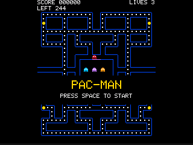

# Pac-Man Clone

> **Demonstration project** — provided as an example of what the PixelRoot32
> Game Engine can do. It is not a product: parts may be incomplete,
> experimental, or deliberately simplified to keep one idea in focus.

A grid-locked arcade maze game in the classic style: run the corridors, clear
every dot, and stay away from the four hunters that patrol the maze. The
interesting part of the demo is not the game itself but how it is put
together — every rule lives in an engine-independent layer that can be
exercised by a host-side test with no graphics session at all.

Language: C++17
Engine: `gperez88/PixelRoot32-Game-Engine@^1.12.0`
Environments: `native`, `esp32dev_ST7789`, `esp32dev_ILI9341`
Category: Games



## Requirements (build flags)

| Flag | Value | Why |
| --- | --- | --- |
| `PIXELROOT32_ENABLE_GAMEPLAY_GRID_SPACE` | `1` | The rules layer moves actors between cells with `pixelroot32::gameplay::GridMotion`. Building without this flag is not an error — the grid primitives are compiled out and the rules layer stops compiling, because `GridMotion` is guarded by the same flag. |
| `PIXELROOT32_ENABLE_AUDIO` | `1` | Sound effects for dots, pellets, defeated hunters, a lost life and a finished level. Building without it is not an error — the game plays silently. |
| `PIXELROOT32_ENABLE_PHYSICS` | `0` | The game resolves its own collisions on the grid; a physics engine would only add a second, conflicting source of truth. |
| `PIXELROOT32_ENABLE_PARTICLES` | `0` | Nothing in the game emits particles. |
| `PIXELROOT32_ENABLE_UI_SYSTEM` | `0` | The interface is a status band and a few text overlays, not a widget tree. |
| `PIXELROOT32_ENABLE_DEPTH_SORT` | `0` | Nothing overlaps, so there is nothing to sort. |

## Platforms

| Environment | Display | Driver | Audio backend | Input |
| --- | --- | --- | --- | --- |
| `native` | 240×240 logical, windowed | SDL2 | SDL2 | Arrow keys, Space, Enter |
| `esp32dev_ST7789` | 240×240 | ST7789 (TFT_eSPI) | ESP32 I2S (MAX98357A-class DAC) | Six GPIO buttons: up, down, left, right, A, B |
| `esp32dev_ILI9341` | 240×320 panel, rotated to 320×240 | ILI9341_2 (TFT_eSPI) | ESP32 I2S (MAX98357A-class DAC) | Six GPIO buttons on the board |

Both environments run the same rules layer. The native build is the fast
iteration loop; the ESP32 builds are the target the demo is written for.

The `esp32dev_ILI9341` environment is the ESP32-2432S028 "Cheap Yellow
Display": an ILI9341 panel with an XPT2046 touch screen. The panel is
mounted in portrait, so the build turns it a quarter turn and the logical
framebuffer becomes 320×240 — the shape the game wants anyway. The touch bus
is left unclaimed: the game is played with the six buttons.

The layout follows the logical size rather than the panel: the status band
stays at the top and the maze is centred in what is left, so the same build
serves both panels.

## Controls

| Action | Native | ESP32 |
| --- | --- | --- |
| Move | Arrow keys | D-pad buttons |
| Pause / resume | Space | Button A |
| New game | Enter | Button B |

A direction pressed before an intersection is remembered and taken at that
intersection, exactly like the arcade original.

## The rules

The demo implements the rule set of the classic game: run the corridors,
collect every dot, and stay away from four hunters that patrol the maze.
The pieces are worth 10 points, a power pellet is worth 50 and turns the
hunters around for six seconds, and a frightened hunter is worth 200, 400,
800 and then 1600 points for consecutive hits inside one power effect. The
player starts with three lives and earns a fourth at every ten thousand
points.

Each hunter hunts in its own way: one goes straight for the player, one
aims four cells ahead of the player, one aims past the player measured from
the first hunter, and one hunts from far away and retreats when the player
gets close. All four find their way by asking a breadth-first route field
for the distance to every neighbouring cell, which makes their behaviour
deterministic and testable.

The level is a table of ASCII rows under `src/rules/PacmanMaze.cpp`. It is
28 columns by 26 rows with four power pellets, a tunnel on each side of the
middle row and a ghost house in the centre. A validator rejects a level with
a ragged row, an open border, a start inside a wall, nothing to collect, or
a corridor that cannot be reached from the player's start — before a game
ever begins.

## The sounds

The demo follows the 1980 Namco cabinet's sound design, synthesised by the engine's
NES-style audio subsystem rather than played from samples:

-   **The theme.** The arcade's jingle, in four bars with a bass line under it. The
    title screen plays it as the attract-mode tune; the level plays it as the
    background music — the same melody, slower and quieter, so it stays out of
    the way of the sound effects. The background music belongs to the level,
    not to the `READY!` beat: it starts once the player is allowed to move,
    and not before.
-   **The waka.** Two notes that alternate on every dot, the way the arcade alternates
    them, so the rhythm of the eating is audible.
-   **The hunters.** Every hunter has a pitch of its own, and the siren that follows the
    player belongs to whichever hunter is closest to him. While the power effect lasts
    the siren becomes a fast, high warble.
-   **The moments.** A chirp that climbs when a hunter is defeated, a long wail that
    falls away when the player is caught, a warble for the power pellet and a rising
    figure for the extra life.

The rules layer never plays a sound: it reports what happened as a set of flags, and the
scene asks for the matching effect. That is what keeps the audio backend out of the
rules, and it is why the game would still play correctly with the audio subsystem
compiled out.

## What it demonstrates

-   **A grid-locked actor.** The player occupies exactly one logical cell at
    a time and interpolates between cells for drawing. Gameplay rules never
    see the player straddling two cells, so a collision is always resolved at
    a cell, not at a frame boundary.
-   **A rules layer with no engine in it.** `src/rules/` holds the maze, the
    player, the enemies, the scoring and the game states. It includes the
    engine's *gameplay* primitives but never its drawing system, its input
    device or its audio backend — which is what makes the whole rule set
    testable headless.
-   **A level as data.** The maze is a table of ASCII rows. A validator
    rejects a level with a ragged row, an open border, a start inside a wall,
    nothing to collect, or a corridor that cannot be reached from the
    player's start — before a game ever begins.
-   **A fixed logic step.** The simulation advances in 20 ms steps, capped at
    four steps per frame, so the game plays the same whether the screen is
    redrawn at 30 or 60 frames per second.
-   **Rules that report, presentation that reacts.** The rules layer never
    plays a sound: it reports what happened as a set of flags, and the scene
    decides what that should look and sound like. The same split keeps the
    audio backend out of the rules.
-   **A synthesised soundtrack.** The theme and the effects are built from
    oscillators and a sequencer instead of samples, so the demo ships no
    binary audio assets at all.

## Project layout

```text
games/pacman/
├── platformio.ini          # envs: native, esp32dev_ST7789, esp32dev_ILI9341, rules_test
├── lib/platformio.ini      # [base] / [base_native] / [base_esp32] templates
├── screenshots/            # screenshot.png
├── src/
│   ├── main.cpp            # platform selector only
│   ├── platforms/          # native.h, esp32_dev_ST7789.h, esp32_dev_ILI9341.h
│   ├── assets/             # generated sprite tables (CC0, original art)
│   ├── audio/              # the sound effects, synthesised rather than sampled
│   ├── PacmanScene.*       # presentation: reads input, draws the rules
│   ├── PacmanPalette.h     # the demo's colours, in one place
│   └── rules/              # the rules layer: no drawing, no input, no audio
│       ├── PacmanConfig.h      # every tunable value, in one place
│       ├── PacmanMaze.*        # the level, its validator and its walkability
│       ├── PacmanRouteField.*  # shortest-route distances over the grid
│       ├── PacmanPlayer.*      # grid-locked movement and buffered turns
│       ├── PacmanEnemy.*       # the hunters, their states and their targets
│       ├── PacmanSession.*     # score, lives, collectibles, game states
│       └── ...
├── test/                   # host-side Unity suite (no graphics session)
│   └── unit/test_pacman_*/
└── tools/
    └── generate_sprites.py # regenerates src/assets/PacmanSprites.h
```

## Build

```bash
pio run -e native
pio run -e esp32dev_ST7789
pio run -e esp32dev_ILI9341
```

Host-side unit suite (no window, no SDL, no hardware):

```bash
pio test -e rules_test
```

The suite compiles only `src/rules`, which is the point: the rules have no
dependency on the drawing system, the input device or the audio backend. The
environment installs the engine for its gameplay headers but never builds it,
so the suite runs on a machine with no display stack at all.

## Upload (ESP32)

```bash
pio run -e esp32dev_ST7789 --target upload
pio device monitor
```

Swap `esp32dev_ST7789` for `esp32dev_ILI9341` on the 240×320 panel.

## Engine documentation

-   Engine repository: <https://github.com/PixelRoot32-Game-Engine/PixelRoot32-Game-Engine>
-   Gameplay framework (`GridSpec`, `GridMotion`): <https://pixelroot32.org/docs/gameplay-framework>
-   Getting started with the engine: <https://pixelroot32.org/docs/getting-started>

## License

-   **Sprite and level artwork** — original work created for this demo by
    `tools/generate_sprites.py` and by hand in `src/rules/PacmanMaze.cpp`.
    Dedicated to the public domain under **CC0 1.0**. The artwork is drawn
    from scratch and is not derived from any copyrighted game's assets.
-   **Code** — MIT, matching the engine's licence.

This demo is a clone of a game *genre*, not of a specific commercial title.
No trademarked names, characters, sounds or level layouts are used.
