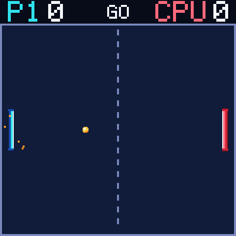

# Pong

> **Demonstration project** — provided as an example of what the PixelRoot32
> Game Engine can do. It is not a product: parts may be incomplete,
> experimental, or deliberately simplified to keep one idea in focus.

One player against the CPU on the arcade court: a navy playfield, `P1` and
`CPU` in the score band, and a single set to five. The single idea it is about
is **determinism**: the whole match lives in an engine-free rules layer written
in Q8.8 fixed point, with no `float`, no clock and no physics at all, so the
same host suite replays a match step by step and compares it field by field.
The generated arcade presentation — a 4bpp ball and paddles, contact particles,
camera shake and five cues — is what wraps that core.

Language: C++17  
Engine: `gperez88/PixelRoot32-Game-Engine@^1.13.0`  
Environments: `native`, `esp32dev_ST7789`, `esp32dev_ILI9341`  
Category: Games



## Requirements (build flags)

Set in [`lib/platformio.ini`](lib/platformio.ini)'s `[base]` template, so
`native` and both device environments inherit them:

| Flag | Value | Why |
| --- | --- | --- |
| `PIXELROOT32_ENABLE_AUDIO` | `1` | The five cues — paddle, wall, goal, countdown, win. Building without it is not an error: the match plays silently. |
| `PIXELROOT32_ENABLE_PARTICLES` | `1` | Contact bursts and the goal spray. The emitter header sits entirely inside the flag, so turning it off means the effect module compiles to nothing. |
| `PIXELROOT32_ENABLE_PHYSICS` | `0` | The court has no rigid bodies. The ball, both paddles and the walls are resolved by the rules layer in integers; a solver would be a second, conflicting source of truth. |
| `PIXELROOT32_ENABLE_UI_SYSTEM` | `0` | The score band and the overlay are `Renderer` text, not a widget tree. |
| `PIXELROOT32_ENABLE_CAMERA_EFFECTS` | `1` | The shake on a goal and on the final point. Nothing scrolls, so the camera exists only for the jolt. |
| `PIXELROOT32_ENABLE_4BPP_SPRITES` | *defined* | The ball and both paddles are `Sprite4bpp` from `src/assets/`. The engine gates that path with `#ifdef`, so a bare define is the only spelling that turns it on — `-D ...=0` would also enable it. |

`rules_test` deliberately does not extend `[base]`: it installs no library
dependency at all, because the suite it runs has no engine in it.

## Platforms

| Environment | Display | Audio | Input |
| --- | --- | --- | --- |
| `native` | SDL2, 240×240 — mirrors the ST7789 board | `SDL2_AudioBackend`, 22050 Hz | Up / Down arrows, Space |
| `esp32dev_ST7789` | ST7789 240×240 | ESP32 I2S (MAX98357A-class DAC) on GPIO 26 / 25 / 22 | Six GPIO buttons: up 32, down 27, left 33, right 14, A 13, B 12 |
| `esp32dev_ILI9341` | ESP32-2432S028 "Cheap Yellow Display": ILI9341 240×320 turned a quarter turn to 320×240 | ESP32 I2S on GPIO 5 / 21 / 19 | Six buttons: up 32, down 33, left 25, right 26, A 27, B 13 |

Both device builds are the same game on two canvases. `PONG_COURT_WIDTH` is the
build flag that picks the canvas — 240 on the square panel and the native
window that mirrors it, 320 on the rotated panel — and both the rules court and
the design box read that one macro, so the simulation and the presentation can
never disagree. `CourtLayout` then proves the composition fits: a chain of
`static_assert`s checks both paddles, the ball, the HUD groups, the phase word
and the overlay band against the selected width, so a court that would draw
off-panel or over the scores fails the build instead of shipping. There is no
letterboxing; `viewOffset()` returns `(0, 0)` on both canvases.

The `esp32dev_ILI9341` environment leaves the XPT2046 touch bus unclaimed: the
game is played with the six buttons, as on the square board.

The three environments build and the host suite is green; the two device
builds were not re-flashed on hardware after the port.

## Controls

| Action | `native` | ESP32 |
| --- | --- | --- |
| Move the left paddle | Up / Down arrows | D-pad up / down |
| Restart after Game Over | Space | Button A |

The right paddle is the CPU and has no input path in a real match. The first
side to five points takes the single set; `PRESS A` (or Space) starts a fresh
one from `P1 WINS` / `CPU WINS`, and the scores go back to 0–0.

## How the CPU plays

The opponent is a proportional controller in Q8.8, in
[`src/game/PongCpu.h`](src/game/PongCpu.h):

- **Gain.** `speed = error * 1.5`, where the error is the distance from the
  ball to the paddle's centre, so a ball far away is chased faster than one
  already in line.
- **Cap.** 60 % of the player's 190 px/s paddle speed, which is 114 px/s. The
  ratio is one constant, and a `static_assert` keeps the cap below the player,
  so the CPU loses every speed race it can lose.
- **Imperfection.** A target offset in `[-3, +3]` px, sampled once per step from
  a 32-bit linear congruential generator. Remove it and the opponent returns
  everything.
- **Dead zone.** An error of 0.5 px or less is ignored, so a centred paddle does
  not buzz against a centred ball.
- **Sub-pixel travel.** Movement accumulates in a `Fixed` remainder and only
  whole pixels are handed to the paddle, so a slow correction is not lost to
  integer truncation.

The noise is **seeded**, not clocked, on purpose: a replay must reproduce the
opponent exactly. `reset()` rewinds the stream to its seed and clears the
remainder, so a rebuilt match is a replay rather than a continuation — which is
what lets one host test run two matches side by side and compare them.

## What it demonstrates

- **Determinism as a tested property.** The rules never read a clock: the scene
  feeds a fixed 60 Hz step from its accumulator, and the only "random" value in
  a match is the CPU's seeded offset. `test_two_rules_replay_the_same_match`
  runs two `Rules` for 1200 steps under an identical input script and compares
  phase, countdown, both scores, the ball position and both paddle positions
  after every single step, plus the event stream's kinds, owners and order.
- **A rules layer with no engine in it.** `src/game/` includes no engine,
  Arduino, display, audio or networking header. It is Q8.8 integers, a
  fixed-size event ring and nothing else, so it compiles into a host test
  binary with no SDL2 and no toolchain beyond the C++ compiler.
- **A generated 4bpp court.** The palette and the ball and paddle sprites are
  emitted as packed tables by `tools/generate_sprites.py` from character grids
  in `tools/art_source.py`. `CourtRenderer` `static_assert`s the sprite
  rectangles against the rules geometry, so art and collision cannot drift.
- **An arcade feedback loop.** The rules report edges — paddle hit, wall bounce,
  goal, serve, match over — and the scene turns them into bursts, shake and
  cues. The rules play no sound and spawn no particle, which is why the same
  core still works with audio and particles compiled out.

## Tests

```bash
pio test -e rules_test
```

22 Unity cases, all on the host:

- **`test/unit/test_pong_rules`** — the court: the opening countdown, the serve,
  paddle movement and clamping, wall and paddle bounces, scoring at each edge,
  the alternating serve sequence, the win at five, restart only from a finished
  match, the event ring's order and drop rule, and the replay comparison above.
- **`test/unit/test_pong_cpu`** — the opponent: the chase in both directions and
  its gain, the dead zone, the speed cap, the play-area clamps, the same script
  under the same seed, and `reset()` restoring the initial state.

The environment compiles `src/game/` only (`build_src_filter = +<game/>`) with
Unity and no engine library, so the suite needs no display and no SDL2 — and any
engine dependency that crept into the rules would break it. CI runs the row in
[`.github/workflows/build.yml`](../../.github/workflows/build.yml).

## Project layout

```text
games/pong/
├── platformio.ini          # native, esp32dev_ST7789, esp32dev_ILI9341, rules_test
├── lib/platformio.ini      # [base] / [base_native] / [base_esp32] templates
├── screenshots/            # screenshot.png — the arcade court at 240x240
├── src/
│   ├── main.cpp            # platform selector only
│   ├── PongScene.h/.cpp    # composition root: input, effects, court pass
│   ├── game/               # engine-free rules, Q8.8, no float, no clock
│   │   ├── PongRules.h/.cpp    court, phases, serve, scoring, event ring
│   │   └── PongCpu.h/.cpp      the proportional opponent
│   ├── presentation/
│   │   ├── CourtLayout.h       design box and the composition static_asserts
│   │   ├── CourtRenderer.h/.cpp court, HUD, phase word, overlay
│   │   ├── PongEffects.h/.cpp   one emitter, one shake
│   │   └── PongSfx.h/.cpp       the five cues behind the audio shim
│   ├── assets/             # GENERATED — PongPalette.h, PongSprites.h
│   └── platforms/          # native.h, esp32_dev_ST7789.h, esp32_dev_ILI9341.h
├── test/
│   ├── test_config.h       # Unity setup/teardown, both empty by design
│   └── unit/
│       ├── test_pong_rules/    the court rules
│       └── test_pong_cpu/      the opponent
└── tools/
    ├── art_source.py       # the editable character grids and 16-slot palette
    └── generate_sprites.py # the 4bpp generator (--check, --preview)
```

## Engine documentation

- [Core API](https://docs.pixelroot32.org/api/core)
- [Graphics / Renderer](https://docs.pixelroot32.org/api/graphics)
- [Audio API](https://docs.pixelroot32.org/api/audio)
- [Input API](https://docs.pixelroot32.org/api/input)
- [Examples catalogue](https://docs.pixelroot32.org/examples/demos)

## Build

From **`games/pong`**:

```bash
pio run -e native
pio run -e esp32dev_ST7789
pio run -e esp32dev_ILI9341
```

The native build needs SDL2: `libsdl2-dev` on Linux, `brew install sdl2` on
macOS, MSYS2/MinGW on Windows. The `[env:native]` flags ship with the
Windows/MSYS2 include and library paths; swap them for the commented Homebrew
lines on macOS, as the other demos in this repository do. To run it:

```bash
pio run -e native --target exec
```

## Upload (ESP32)

```bash
pio run -e esp32dev_ST7789 --target upload
pio run -e esp32dev_ILI9341 --target upload
pio device monitor
```

## License

Source code: [MIT](../../LICENSE).

| Asset | Author | License | Source |
| --- | --- | --- | --- |
| Ball and paddle sprites (6×6, two paddles at 6×44) | This repository | CC0 1.0 (public domain) | Original work, drawn as character grids in [`tools/art_source.py`](tools/art_source.py) and emitted into `src/assets/` by [`tools/generate_sprites.py`](tools/generate_sprites.py) |
| Five arcade cues | This repository | CC0 1.0 (public domain) | Original work, synthesised at runtime from `AudioEvent` definitions in [`src/presentation/PongSfx.cpp`](src/presentation/PongSfx.cpp) |

The generated headers are the shipped artefact; edit the grids and re-run the
generator. `python tools/generate_sprites.py --check` re-renders in memory,
writes nothing and exits non-zero if a header is stale, which is how a
hand-edited sprite is caught before it ships.
