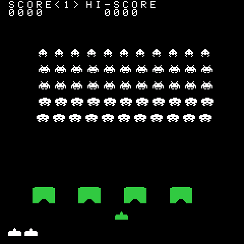

# Space Invaders

> **⚠️ UNOFFICIAL CLONE — DEMONSTRATION ONLY**
>
> A **clone of the original 1978 arcade game**, written from scratch and shipped
> **for demonstration purposes only**: a teaching piece showing how the
> PixelRoot32 engine's APIs fit together, not a product. *Space Invaders* is a
> trademark of **Taito Corporation**; this demo is not affiliated with, endorsed
> by, or licensed by Taito, and reproduces none of the original's code or data,
> only the rules of a genre reimplemented for four decades.

> **ARTWORK PROVENANCE**
>
> The masks in [`src/assets/`](src/assets) - cannon, aliens, saucer, shots, death
> frames, shields - were **drawn by hand in this repository** against a reference
> arcade sprite sheet: same silhouettes and frame counts, typed in as `uint16_t`
> rows, never traced or sampled. The 8x8 font is transcribed glyph by glyph from
> the sheet's character table. The sheet is local working material, not tracked
> here, so no third-party image ships; the code is MIT and the artwork is a
> visual reimplementation, **not offered under a public-domain dedication**.

A clone of the 1978 fixed-shooter: a 5 x 11 rack marching down on four shields
that erode pixel by pixel, a mystery saucer, three ships, and a march beat that
tightens as the formation thins. Its idea is **a fixed memory budget** — arena,
projectile pool and explosion slots sized once at compile time, so a full wave
runs without a runtime allocation.

Language: C++17  
Engine: `gperez88/PixelRoot32-Game-Engine@^1.9.0`  
Environments: `native`, `esp32dev_ST7789`, `esp32dev_ILI9341`  
Category: Games



## Requirements (build flags)

All set in [`lib/platformio.ini`](lib/platformio.ini)'s `[base]` template:

- **`PIXELROOT32_ENABLE_SCENE_ARENA`** — entities come from `arenaNew` into the
  8 KB `SPACE_INVADERS_SCENE_ARENA_BUFFER`, or from `std::unique_ptr` and the
  heap when the flag is off; both branches sit behind `#ifdef` in
  [`src/scenes/SpaceInvadersScene.cpp`](src/scenes/SpaceInvadersScene.cpp).
- **`PIXELROOT32_ENABLE_PHYSICS=1`** — required: `RigidActor` (shots),
  `KinematicActor` (ship), `StaticActor` (shields, saucer) and the swept helpers
  in `physics/CollisionSystem.h` live behind it.
- **`PIXELROOT32_ENABLE_AUDIO=1`** — the march beat and the five effects; without
  it the build succeeds and plays nothing.
- **`PIXELROOT32_ENABLE_PARTICLES=0`, `PIXELROOT32_ENABLE_UI_SYSTEM=0`** — a kill
  is two five-pixel bars drawn by the scene and the death a two-frame 13x8 mask;
  the HUD is `Renderer::drawText` in the 8x8 arcade font, not UI widgets.

Display is **240×240**, playfield 224 px wide at `x=8`, drawn 1:1; every row,
pitch and spawn position derives from it in [`src/GameConstants.h`](src/GameConstants.h)
and [`src/rules/RulesConstants.h`](src/rules/RulesConstants.h). On the Cheap
Yellow Display the logical canvas is 320×240, so the same 224 px field sits at
`x=48` and is centred rather than left-aligned.

## Platforms

| Environment | Display | Audio backend |
|-------------|---------|----------------|
| **`native`** | SDL2, 240×240 | `SDL2_AudioBackend` in [`src/platforms/native.h`](src/platforms/native.h) |
| **`esp32dev_ST7789`** | **ST7789** 240×240 | `ESP32_I2S_AudioBackend` in [`src/platforms/esp32_dev_ST7789.h`](src/platforms/esp32_dev_ST7789.h) |
| **`esp32dev_ILI9341`** | **ILI9341** 240×320 (ESP32-2432S028 "Cheap Yellow Display"), rotated to 320×240 | `ESP32_I2S_AudioBackend` in [`src/platforms/esp32_dev_ILI9341.h`](src/platforms/esp32_dev_ILI9341.h) |

Pins for ST7789, I2S and the D-pad are in `src/platforms/esp32_dev_ST7789.h`;
the CYD's ILI9341, I2S and six-button map are in
`src/platforms/esp32_dev_ILI9341.h`.

## Controls

| Action | `native` (keyboard) | `esp32dev_ST7789` (GPIO) | `esp32dev_ILI9341` (GPIO) |
|--------|----------------------|--------------------|--------------------|
| Move ship | Left / Right arrows | D-pad Left / Right (33 / 14) | D-pad Left / Right (25 / 26) |
| Fire | Space | Button A (13) | Button A (27) |
| Restart (from Game Over) | Space | Button A | Button A |

The cannon is **continuous**: one pixel per rules tick while a direction is
held, clamped to the playfield edge; no lanes, no easing, and both or neither
button held moves nothing. Fire is one shot at a time: a press fires only when
no player shot is in flight **and** the button was released since the previous
shot, so holding does not auto-repeat and a mid-flight press is ignored.

## Rules as implemented

**The clock.** Everything runs on a fixed 60 Hz step of 16.667 ms, at most five
ticks per frame with the surplus dropped, so a stalled frame cannot teleport the
rack; the frame draws after its last tick.

**The rack.** 5 x 11 = 55 aliens on a 16 px pitch — squid 30 points on row 1,
crab 20 on rows 2-3, octopus 10 on rows 4-5 — top-left 26 px into the field at
y=48. One live alien moves per tick, so a sweep takes as many ticks as there are
live aliens and the march accelerates as it thins; the frame flips once per
completed sweep, the only animation clock. A sweep shifts 2 px, or 3 px with one
alien left; on the edge it reverses and drops 8 px against the outermost live
sprite (left 2, right 222). A kill freezes it 10 ticks; the sweep resumes where
it stopped. A cleared rack restarts 8 px lower, to the deepest origin it fits.

**Enemy fire.** Three bolts at most, a 3x7 mask with two frames. Every third
tick each live bolt steps 4 px, or 5 px under nine aliens, and flips its frame;
the shooter is the lowest alien of a randomly chosen live column, read from the
rack grid. The reload is a budget in shot steps, indexed by the score's high
byte: 48, then 16, 11, 8, 7 past `0x02`, `0x10`, `0x20`, `0x30`. It charges even
with all three slots full, and a band change re-arms it; columns come from the
run's xorshift32 generator, reseeded to `0x1978`.

**Shields.** Four 22x16 masks at `x=32, 77, 122, 167`, `y=184`, with two pixels
cut from each top corner and a widening arch through the bottom four rows. A hit
walks the shot's segment from the previous tick one pixel at a time and erodes a
3x3 blast at the first solid pixel; a path through a hole the shield already
lost erodes nothing, so that shot flies on. There is no health counter and no
shrinking height: a shield that loses every bit is gone, and all four are rebuilt
per wave.

**The saucer.** A 16x7 mask crossing `y=24` at 2 px per tick, entering fully
outside the field when a 1536-tick period expires (only while nothing is on
screen) and at least eight aliens are alive. Its side is the parity of the
player's shot counter (even enters left, odd right), and its value cycles a
15-entry table: 100, 50, 50, 100, 150, 100, 100, 50, 300, 100, 100, 100, 50,
150, 100. A hit shows that number where it died for a second, and a siren plays
while it crosses.

**Score, ships, waves.** Four digits clamping at 9999, a session high score
surviving a restart, three ships, one extra ship at 1500 (once per run, silent),
reserve ships as cannon icons. Clearing the rack advances the wave: shields
restored, formation 8 px lower, shots and bursts cleared, score and ships kept.
There is no win state.

**How a run ends.** **Invasion**: an alien's bottom reaches the cannon baseline
at `y=216` and the run ends on that tick; the ship was never hit. **Last ship**:
a bolt hits with no reserve left. Both show `GAME OVER` / `PRESS FIRE`.

**The death sequence.** A surviving hit spends a ship: the cannon vanishes, all
shots in flight clear, and the two-frame 13x8 burst alternates once per tick
where the ship died. Every other rules step is skipped for a fixed 30 ticks, so
the wave resumes where it stopped; then the cannon returns at the left edge,
fire gated until release. The last ship ends the run immediately, with no hold.

## Audio

There is no music track. The march is **one short tone per beat**: a four-tick
pulse rotated through four voices, with the gap from a live-count table (52, 46,
39, 34, 28, 24, 21, 19, 16, 14, 13, 12, 11, 9, 7, 5 ticks for 50, 43, 36, 28,
22, 17, 13, 10, 8, 7, 6, 5, 4, 3, 2, 1 aliens, and 52 above that). The beat
keeps its own clock: the sweep length *is* the live count while the beat reads
the table, so the two deliberately drift, as on the original board.

Five effects fire as one-shots: the shot (0.09 s pulse sweep), the kill (0.11 s
bright noise), the player death (low noise held for exactly the 30-tick pause),
the saucer siren (0.2 s pulse sweep re-fired every 12 ticks while it is on
screen) and the saucer hit (0.35 s triangle sweep). They share the four SFX
voices with the march, and nothing reserves a slot.

Two figures are **provisional, not transcribed**: the four march pitches (110,
104, 98, 92 Hz) are a stated placeholder, because the documentation gives the
rotation, the interval table and the four-tick hold but not the pitch of each
analog voice; and the 30-tick death hold is the disassembly's "flips between two
images for half a second" at 60 Hz, its cadence undocumented. Both wait on the
capture comparison in [Verification](#verification).

## Memory

| Item | Value |
|------|-------|
| Arena buffer | 8192 bytes |
| One full wave | 7784 bytes (216 player + 55 x 80 aliens + 4 x 192 shields + 12 x 200 shots), 408 free |
| Entities | 72 registered against `MAX_ENTITIES=80` |

Measured from the native build and re-checked by the compiler: per-actor
`static_assert`s, the total, the headroom and the entity count all fail the
build if the wave stops fitting, and failed `arenaNew` calls are counted and
asserted zero after the first wave in a debug build. The 12-slot pool is shared
by the player's shot and the enemy's three; the eight explosion slots hold
200 ms bursts. The wave is allocated once in `resetGame()` and `advanceWave()`
reuses the same actors, so nothing in a run reaches the allocator.

## What it demonstrates

- **Swept-circle collision from a shadowed previous position.** A four-pixel
  step can cross an eight-pixel alien between two frames, so `ProjectileActor`
  records where the tick started — shadowing the base class field on purpose —
  and the scene sweeps a circle from there, falling back to a plain overlap.
- **One animation clock.** `AlienActor::update()` is empty and the rack owns the
  frame, so the whole formation flips in lockstep.
- **A budget the compiler defends.** Arena, pool and effect slots are sized once
  and the assertions proving they still fit are part of the build.
- **An engine-free rules layer.** [`src/rules/`](src/rules) includes `<cstdint>`
  and nothing else, so the panel code is tested on the host: 13 suites, 92
  cases, including a scripted-run replay that a fixed tick and a seeded
  generator make reproducible.

## Project layout

```
src/
├── assets/                        BandColor (overlay band), FontData
│   └── sprites/                   AlienSprites, PlayerSprites, SaucerSprites,
│                                  PlayerExplosionSprites (two frames), ShotSprites
├── actors/                        AlienActor, BunkerActor, PlayerActor, ProjectileActor, SaucerActor
├── scenes/                        SpaceInvadersScene.h/.cpp — arena, tick loop, collisions, HUD, audio
├── rules/                         engine-free: Rack, RulesConstants, FixedStep, FireTiming,
│                                  Shots, ShieldMask, Saucer, MarchSound, Scoring, Rng
├── platforms/                     native.h, esp32_dev_ST7789.h, esp32_dev_ILI9341.h
│                                  — backend wiring
├── GameConstants.h                screen model, input IDs
└── main.cpp                       platform selector

test/                              13 suites, 92 cases: rules/smoke, rack, march, cannon,
                                   shots, fire, shields, saucer, scoring, fixed step, rng, replay
```

## Engine documentation
- [Physics API](https://docs.pixelroot32.org/api/physics)
- [Graphics / Renderer](https://docs.pixelroot32.org/api/graphics)
- [Audio API](https://docs.pixelroot32.org/api/audio)
- [Core API](https://docs.pixelroot32.org/api/core)
- [Memory system — flags and byte budgets](https://docs.pixelroot32.org/architecture/memory-system)

## Build

From **`games/space_invaders`**:

```bash
pio run -e native
pio run -e esp32dev_ST7789
pio run -e esp32dev_ILI9341
```

## Verification

| Command | What it proves |
|---------|----------------|
| `pio test -e host_test` | The rules layer alone: 55 cells, sweep length from the live count, the 3 px last alien and 8 px drop, the reload ladder, the 15-value saucer sequence, shield erosion and the pass-through hole, the 1500-point ship, the wave offset, the march intervals, and a scripted-run replay. No display, no SDL. |
| `pio run -e native` | The whole game links and builds for SDL2 at 1:1, and every arena-budget assertion holds. |
| `pio run -e esp32dev_ST7789` | The device target with the ST7789 and I2S wiring compiles. |
| `pio run -e esp32dev_ILI9341` | The Cheap Yellow Display target compiles with the ILI9341, its rotation and its button map; the `static_assert` in `GameConstants.h` proves the 224 px field fits the 320×240 canvas at `x=48`. |

Still pending: a full run on the panel, and the capture comparison at fixed
ticks against a reference recording — what the provisional figures wait on.

## Upload (ESP32)

```bash
pio run -e esp32dev_ST7789 --target upload
pio run -e esp32dev_ILI9341 --target upload
```

## License

Source code: [MIT](../../LICENSE).

| Asset | Author | License | Source |
|-------|--------|---------|--------|
| Cannon, alien, saucer, shot, death frames, shields | This repository | Not CC0: a visual reimplementation, published for demonstration only | Hand-drawn against a reference arcade sprite sheet, as `uint16_t` rows in [`src/assets/`](src/assets) |
| 8x8 arcade font | This repository | Not CC0: a visual reimplementation, published for demonstration only | Transcribed glyph by glyph from the same sheet, in [`src/assets/FontData.h`](src/assets/FontData.h) |
| March beat and the five effects | This repository | CC0 1.0 (public domain) | Original work, synthesised at runtime from `AudioEvent` data in `src/` |

The masks are hand-drawn here and no third-party image ships with the project,
but they depict the arcade's sprites, so they carry no public-domain dedication
of their own.

## Sources

- Computer Archaeology, *Space Invaders* — code walkthrough and disassembly: the
  rack loop (one live alien per interrupt, the 8 px drop, the 3 px last alien),
  the march interval and four-voice tables, the reload ladder, the 15-entry
  saucer table, and the player task's two-image death, described as half a
  second. <http://computerarcheology.com/Arcade/SpaceInvaders/>
- walkofmind, *Space Invaders sound hardware* — the march's voice rotation:
  <http://www.walkofmind.com/programming/space.htm>
