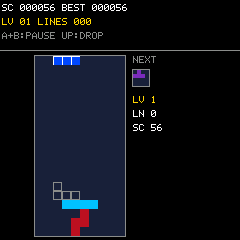

# Tetris

> **Demonstration project** — provided as an example of what the PixelRoot32
> Game Engine can do. It is not a product: parts may be incomplete,
> experimental, or deliberately simplified to keep one idea in focus.

Classic falling-block Tetris on a 240×240 display: seven tetrominoes,
7-bag queue, next-piece preview, ghost piece, line clears, score × level,
speed curve, pause and game over — drawn entirely with `Renderer`
primitives, no sprites, no asset headers. The single idea it is about is
the **engine-free rules core**: `Board`, `Tetromino`, `PieceGenerator`,
`CollisionSystem`, `LineClearSystem`, `ScoringSystem` and `TetrisSession`
never include an engine, SDL2 or Arduino header, so the same logic compiles
for the host unit tests (`pio test -e host_test`) and for both targets
unchanged.

Language: C++17  
Engine: `gperez88/PixelRoot32-Game-Engine@^1.9.0`  
Environments: `native`, `esp32dev`, `host_test`  
Category: Games



## Requirements (build flags)

Set in [`lib/platformio.ini`](lib/platformio.ini)'s `[base]` template, so
every environment inherits them:

- **`PIXELROOT32_ENABLE_AUDIO=1`** — required. Move/rotate/lock/clear cues
  go through `AudioEngine`. Building without it is not a compile error —
  it is silence.
- **`PIXELROOT32_ENABLE_PHYSICS=0`** — the well is a fixed `Cell[200]`
  array and every rule is an array lookup. There is nothing to simulate.
- **`PIXELROOT32_ENABLE_PARTICLES=0`** — not used.
- **`PIXELROOT32_ENABLE_UI_SYSTEM=0`** — title, HUD and banners are
  `Renderer` text and rectangles, not UI widgets.

Display size is **240×240** in the project `platformio.ini` (see
`PHYSICAL_DISPLAY_*`). The well is 10×20 with 8 px cells (80×160),
centred next to a 72 px side panel for the next piece, level, lines and
score under a 52 px HUD.

## Platforms

| Environment | Display | Audio backend |
|-------------|---------|----------------|
| **`native`** | SDL2, 240×240 | `SDL2_AudioBackend` in [`src/platforms/native.h`](src/platforms/native.h) |
| **`esp32dev`** | **ST7789** 240×240 | `ESP32_I2S_AudioBackend` in [`src/platforms/esp32_dev.h`](src/platforms/esp32_dev.h) |
| **`host_test`** | none (rules core only) | none |

Pin choices (ST7789 SPI, I2S audio, D-pad + two buttons) are in
`src/platforms/esp32_dev.h` — edit there if your wiring differs.

## Controls

The 6-button pad has no dedicated Start/select, so pause is an A+B chord
(spec hard drop stays on D-pad Up, which is always available):

| Action | `native` (keyboard) | `esp32dev` (GPIO) |
|--------|----------------------|--------------------|
| Move left / right | Left / Right (hold for DAS auto-repeat) | D-pad Left / Right (hold for DAS) |
| Soft drop | Down (held) | D-pad Down (held) |
| Hard drop | Up | D-pad Up |
| Rotate clockwise / confirm | X | Button A |
| Rotate counter-clockwise | Z | Button B |
| Pause / resume | X + Z together | A + B together |
| Start / retry (title, game over) | X | Button A |
| Back to title (game over) | X + Z together | A + B together |

Rotations and hard drops fire on fresh edges only, so holding a button
never double-rotates or double-drops. Left/right auto-repeat after 170 ms
every 50 ms. After game over, input is ignored for 600 ms so the press
that ended the run cannot immediately restart it.

Attract mode: 15 s without a button press on the title screen starts an
AI demo (`SceneState::Demo`, `TITLE_ATTRACT_DELAY_MS`). The machine plays
on its own `TetrisSession`, so the player's best score is never polluted,
and restarts silently on game over instead of showing the game-over
screen. Pressing A during the demo returns to the title screen, from
where A starts a player run.

## What it demonstrates

- **Engine-free rules core.** `src/game/` includes nothing but `<cstdint>`,
  so `host_test` compiles it with no display and no SDL2. `Board` is 200
  bytes, pieces are 4×4 integer offsets, the bag is 7 bytes — zero heap,
  zero per-frame allocation.
- **Deterministic 7-bag.** `PieceGenerator` shuffles with Fisher–Yates over
  xorshift32; equal seeds reproduce equal queues (covered by
  `test_game_flow`).
- **Time-based gravity.** `TetrisSession::update(deltaMs, softDrop)` banks
  elapsed time against `ScoringSystem::fallIntervalMs(level)`; long stalls
  clamp to 250 ms so a pause hitch can never multi-drop rows. The lock
  delay is 500 ms; pausing is free because the scene simply stops calling
  `update()`.
- **Simple wall kicks.** Rotations try straight, ±1, then ±2 cells before
  rejecting — safe next to walls and stacks without full SRS tables.
- **Ghost piece.** `ghostY()` drops a probe to the stack; the scene draws
  it as an outline and never writes it into the board.
- **Spec deviations, documented.** `TetrisGame`/`GameState`/`GameRenderer`
  from the spec live inside `TetrisSession` (rules) + `TetrisScene`
  (presentation) following the minesweeper/tic-tac-toe demo convention —
  same responsibilities, fewer files. Hold piece, persistent records and
  particle effects are out of scope for this demo (spec sections 1/14);
  the best score is RAM-only.

## Project layout

```
src/
├── TetrisConstants.h       HUD geometry, adaptive cell size, lockout timing
├── audio/
│   └── TetrisMusic.h         ambient BGM (Korobeiniki-inspired, 96 BPM, no drums)
├── game/
│   ├── TetrisTypes.h       Cell, TetrominoType, ActivePiece, GameStatus
│   ├── Board.h/.cpp        10x20 fixed storage, bounds-checked access
│   ├── Tetromino.h/.cpp    spawn shapes + CW rotation in 3x3/4x4 boxes
│   ├── PieceGenerator.h/.cpp  7-bag over xorshift32, reproducible seeds
│   ├── CollisionSystem.h/.cpp placement validation (walls/floor/stack)
│   ├── LineClearSystem.h/.cpp bottom-up clear + compaction
│   ├── ScoringSystem.h/.cpp 100/300/500/800 x level, 10-line levels
│   └── TetrisSession.h/.cpp gravity, lock delay, ghost, hard drop, over
│   └── TetrisAi.h/.cpp       attract-mode brain: 1-ply El-Tetris heuristic
├── input/
│   ├── InputBindings.h     button indices, command bits, DAS timings
│   └── InputController.h/.cpp  edge detection, DAS repeat, A+B chord
├── ui/
│   └── TetrisScene.h/.cpp  title, HUD, well, next panel, pause, game over, demo
├── main.cpp                platform selector
└── platforms/              native.h, esp32_dev.h — backend wiring per target
test/
├── test_board/             storage, bounds, row queries
├── test_collision/         walls, floor, stacks, spawn entry
├── test_rotation/          shape integrity, kicks, O invariance
├── test_line_clear/        single/double/tetris, top/mid/bottom, compaction
├── test_scoring/           base table, level curve, drop bonus, saturation
├── test_game_flow/         bag fairness, lock/next, pause, restart, seeds
└── test_ai/                pose validity, line-clear greed, determinism
```

## Engine documentation

- [Audio API](https://github.com/PixelRoot32-Game-Engine/PixelRoot32-Game-Engine/blob/main/docs/api/audio.md)
- [Core API](https://github.com/PixelRoot32-Game-Engine/PixelRoot32-Game-Engine/blob/main/docs/api/core.md)
- [Graphics / Renderer](https://github.com/PixelRoot32-Game-Engine/PixelRoot32-Game-Engine/blob/main/docs/api/graphics.md)
- [Input API](https://github.com/PixelRoot32-Game-Engine/PixelRoot32-Game-Engine/blob/main/docs/api/input.md)

## Build

From **`games/tetris`** (use the PlatformIO environment, e.g.
`C:\Users\Gperez\.platformio\penv\Scripts\pio.exe` on this machine):

```bash
pio run -e native
pio run -e esp32dev
```

## Tests

```bash
pio test -e host_test
```

Runs the seven host suites (no display, no SDL2): board bounds, collision
walls/floor/stacks, rotation integrity and kicks, single-to-tetris clears
with compaction, scoring table and level curve, plus game-flow fairness,
lock/next pipeline, pause freeze, restart invariants and seed
reproducibility.

## Upload (ESP32)

```bash
pio run -e esp32dev --target upload
```

## License

Source code: [MIT](../../LICENSE).

| Asset | Author | License | Source |
|-------|--------|---------|--------|
| All audio cues | This repository | CC0 1.0 (public domain) | Original work, synthesised at runtime from `AudioEvent` definitions in `src/` |

This demo ships no art and no generated asset headers — the well, pieces,
digits and banners are `Renderer` primitives, so there is nothing else
here to attribute.
