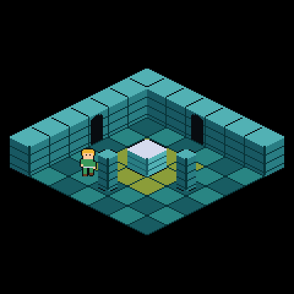

# iso_dungeon — an isometric dungeon on a generic projection

> **Demonstration project** — provided as an example of what the PixelRoot32
> Game Engine can do. It is not a product: parts may be incomplete,
> experimental, or deliberately simplified to keep one idea in focus.

> **Requires engine 1.10.0 or newer.** This demo uses the projection API
> (`gameplay/Projection.h`, `math/Projection.h`, the sprite span fields
> `rowMinX`/`rowMaxX`, `graphics/StaticLayerSnapshot.h`), which first ships in
> `1.10.0`.

Language: C++17  
Engine: `gperez88/PixelRoot32-Game-Engine@^1.10.0`  
Environments: `native`, `esp32dev`  
Category: Graphics



> **Two isometric demos, two questions.**
> [`iso_tilemap_export`](../iso_tilemap_export) is the **pipeline** demo: does
> the engine paint what the Tilemap Editor showed? This one is the **gameplay**
> demo: once the tiles are on screen, how do actors move and sort on them
> — exact tile-to-tile motion through `GridMotion`, projection-aware depth
> ordering via `compareByDepthKey`, and rooms wired by a `RoomGraph`. Read the
> other one first if you are bringing a map in; read this one if you already
> have one.

Three dungeon rooms drawn in 2:1 isometric, with a hero that walks them tile by
tile and passes between them through doorways. The opening room has two stone
walls along its back edges with a doorway in each, an altar on a ritual square,
and two pillars flanking it; the doors lead to a pillar hall and a shrine.

The point of the example is not the dungeon. It is that **PixelRoot32 has no
isometric mode**. The view here is one `gameplay::ProjectionSpec` — six
integers — and every other system in the example is the same
projection-blind code an axis-aligned game would use.

## The whole isometric view

```cpp
inline constexpr pixelroot32::math::ProjectionSpec ISO_PROJECTION{
    120, 88,      // screen position of tile (0,0)'s diamond centre
     16,  8,      // +1 tileX -> right and down
    -16,  8};     // +1 tileY -> left  and down
```

Those six integers are the Tilemap Editor's export of the project in
[`editor/`](editor/) (`src/assets/tilemap/iso_dungeon_rooms.h`); the game
names them `kTileProjection` in `IsoDungeonConstants.h`.

That is it. Orthogonal, isometric 2:1, isometric 1:1, oblique and mirrored
layouts are all *values* of this one type; there is deliberately no isometric
function, enum or template parameter anywhere in the engine. Point
`kTileProjection` at `{0, 0, 16, 0, 0, 16}` and this example becomes a
top-down board game with no other edit.

## Build flags

The feature flags as set in `lib/platformio.ini`. The `=1` entries are required
for the example to work as described; the `=0` entries are deliberately off to
save Flash/RAM.

| Flag | Why |
|---|---|
| `PIXELROOT32_ENABLE_AUDIO=1` | On in the shared base profile so the platform stub can instantiate its `SDL2_AudioBackend`. The example emits no sound. |
| `PIXELROOT32_ENABLE_PARTICLES=0` | No particles. Disabled to save Flash/RAM. |
| `PIXELROOT32_ENABLE_PHYSICS=0` | Movement is tile-based (`GridMotion`), not physics. Disabled to save Flash/RAM. |
| `PIXELROOT32_ENABLE_UI_SYSTEM=0` | No menus or HUD. Disabled to save Flash/RAM. |
| `PIXELROOT32_ENABLE_PROJECTION=1` | `Projection.h`. Without it the header compiles to nothing and the room has no geometry at all. |
| `PIXELROOT32_ENABLE_TILEMAP_PROJECTION=1` | `Renderer::drawTileMap`'s projected overload. The floor's diamonds are placed by one `drawTileMap` call instead of 49 hand-rolled `drawSprite` calls. Requires `PROJECTION=1`. |
| `PIXELROOT32_ENABLE_DEPTH_SORT=1` | `Entity::depthKey` and `gameplay::compareByDepthKey`. Off, entities draw in insertion order and the occlusion is simply wrong half the time. |
| `PIXELROOT32_ENABLE_GAMEPLAY_GRID_SPACE=1` | `gameplay::GridMotion`. This example declares no `GridSpec` at all, but `GridMotion` shares the grid flag rather than taking one of its own — see below. |
| `PIXELROOT32_ENABLE_GAMEPLAY_ROOM=1` | `gameplay::RoomGraph`. Holds which door leads where, the current room index, and the `onEnter` callback the whole transition hangs off. |
| `PIXELROOT32_ENABLE_2BPP_SPRITES=0` | The art is 4bpp; the 2bpp draw paths stay compiled out. |
| `PIXELROOT32_ENABLE_4BPP_SPRITES=1` | The art is 4bpp on a custom 16-colour palette. Not cosmetic: the engine gates its 4bpp draw paths with `if constexpr`, so building without it is not an error, it is a black screen. |
| `PIXELROOT32_ENABLE_STATIC_LAYER_SNAPSHOT=1` | Caches the drawn room so a static floor costs one memcpy per frame instead of 49 sprite blits. |
| `PIXELROOT32_ENABLE_DIRTY_REGIONS=1` | Narrows that restore to the cells last frame's movers disturbed. Without it the snapshot still works, it just restores the whole 57,600 B buffer. |

## What the example actually demonstrates

### Movement is projection-blind

The hero walks **exact tile to exact tile** — always either at rest on a cell
or travelling between two named cells, never anywhere else.
`gameplay::GridMotion` holds that state and `gameplay::tickStep` advances it,
on a fixed 16 ms logic clock so a slow frame stretches nothing.

`HeroActor` supplies only the two policies the engine deliberately does not
own: which cell may be entered, and where the direction comes from. The
isometric view enters in exactly **one line**:

```cpp
position = gameplay::interpolatedWorld(motion_, kStepsPerCell, kTileProjection);
```

That overload projects both endpoints through the spec and lerps between them.
Under a non-identity basis a step along one cell axis moves **both** screen
axes, which the `GridSpec` overload cannot express — and it is the whole
reason an isometric game does not reimplement cell-to-cell navigation.

### The D-pad needs no remapping

Under `kTileProjection` the cell axes project to the four screen **diagonals**:
`+cellX` goes down-right, `+cellY` down-left. So the four buttons already cover
the four directions a player can see, and the input code is byte-identical to
an orthogonal game's.

This is a property of *this* basis, not a general truth. A game with a
different basis has to decide it again, and the engine takes no position.

### Row-major iteration IS the painter's order

`RoomRenderer` draws the floor and walls in one plain `for y / for x` sweep,
with no sort. Screen depth under this spec is `8 * (x + y)`, so a tile is always
drawn after both `(x-1, y)` and `(x, y-1)` — exactly the two neighbours whose
extruded blocks can overlap it from behind.

The back walls are drawn in that same static pass rather than as sorted
entities, and that is not a shortcut: both walls hug the two back edges, so
their depth is lower than any reachable tile's. Nothing the player can stand on
is ever behind them.

### Occlusion is real, and it is the engine's depth sort

The altar and the two pillars are **entities**, on the same render layer as the
hero, for exactly one reason: the hero can reach tiles on both sides of them,
so whether a prop draws over or under the hero changes from frame to frame.

Each entity writes its own `depthKey` from its projected anchor and the scene
uses `gameplay::compareByDepthKey`. `compareByBottomY` would be **wrong** here:
it orders by world Y, which is the correct paint order only while screen depth
is a monotone function of world Y — true for an axis-aligned room, false the
moment a projection shears the grid. Cells `(2,0)` and `(0,2)` sit on the same
screen row at completely different cell-space Ys.

Verified both ways against the same altar (`depthKey` 136):

| Hero tile | `depthKey` | Result |
|---|---|---|
| `(3, 2)` | 128 < 136 | the altar draws over the hero |
| `(3, 4)` | 144 > 136 | the hero draws over the altar |

Screen Y happens to **be** the isometric depth for this spec, because
`cellToScreenY` reduces to `originY + 8 * (x + y)` when both cell axes share a
vertical component. That identity is a property of this basis, not of
projections in general — which is exactly why the engine takes the key as data
instead of deriving it.

### The dungeon is a graph, not a map

`RoomGraph` stores topology — which room a door opens onto — and nothing else:
no tiles, no sprites, no spawn points, because those differ for every game with
rooms. `RoomCatalog.h` supplies them, and the two are joined by using the same
room index for both.

The doors do **not** line up on a plane, and that is forced by the art rather
than chosen. Doorway sprites exist only for the two back walls, because a wall
drawn along a room's front edge has a *higher* screen depth than the tiles
behind it and would paint straight over the hero standing there. That is the
isometric front-wall problem. So every door is carved into a back wall, you
leave room 0 walking up-right and arrive beside room 1's up-left door, and the
connection is topological.

`RoomGraph` models exactly that — its `RoomDir` slots are keys, not geometry —
which is why an example with no spatial room grid can still use it unchanged.
The graph is built from the editor project's exported room layer (`RoomData`
plus `RoomLayer`, one room per 7x7 rect). The camera rects it also stores are
not used here: one room is one screen, so nothing scrolls, and the scene passes
no camera to `enterRoom()`.

### Arriving through a door always faces you forward

You reach a door by walking *into* a back wall, so the hero's pose at that
moment is its back. Carrying that facing through the door would stand you in
the new room looking like you arrived walking backwards.

`HeroActor::enterRoom` turns the hero along the step from the door to the tile
it lands on, reusing the same facing rule walking uses so the two cannot
disagree about which way `+x` faces. Because doors only ever sit on back walls,
that step is always `+x` or `+y` — both of which project toward the camera. The
forward-facing arrival is therefore a consequence of where doors can be, not a
rule bolted on top, and `everyArrivalFacesInward` asserts at compile time that
no arrival tile escapes it.

### The catalog checks itself at compile time

`RoomCatalog.h` is hand-written in four places that have to agree — layout
chars, prop list, door list, arrival tiles — and every disagreement is silent
at runtime: a prop drawn with nothing under it, a door leading nowhere, a hero
spawned inside a wall, a player bounced between two rooms forever. Each is a
`static_assert` instead:

| Assert | Catches |
|---|---|
| `propsMatchLayout` | a prop on a tile the layout does not declare, or an `A`/`P` tile with no prop |
| `doorsAreWellFormed` | a door off a doorway char, a target room that does not exist, an arrival inside a wall, or an arrival **on** a door — which would re-trigger the transition and bounce the player straight back |
| `everyDoorIsTwoWay` | a one-way room, and an arrival that does not land beside the door you came out of |
| `everyArrivalFacesInward` | an arrival with no door beside it, which would leave the hero facing whatever way it last walked |
| `exportedRoomsMatchDoors` | an editor project whose room connections no longer match the door table (a reconnected room, a moved door, a room added on one side only) |

Move a pillar in a layout and the build stops at the line that caused it.

## Decisions worth knowing about

**The tile size was not free.** 32x16 is the largest 2:1 tile that keeps a 7x7
room inside a 240 px display without scrolling: `(7 + 7) * 16 = 224`. A 48x24
tile would need 336 px. A `static_assert` also pins the basis determinant at
256 — a power of two, so `screenToCell`'s single division strength-reduces to a
shift. Change the tile size carelessly and that assert is what stops you.

**`GAMEPLAY_GRID_SPACE` is on for a capability it does not name.** `GridMotion`
shares the grid flag rather than taking a `..._GAMEPLAY_GRID_MOTION` of its
own, so an isometric game that wants cell-to-cell navigation must enable the
grid flag even though it never declares a `GridSpec`. `GridMotion.h` states
this outright. The cost is one unused header, not one unused byte.

**This room draws through the projected tilemap path.** `drawTileMap` places,
culls and marks cells through a `math::ProjectionSpec`
(`PIXELROOT32_ENABLE_TILEMAP_PROJECTION`), so the floor's diamonds are placed
by one projected `drawTileMap` call instead of 49 hand-rolled `drawSprite`
calls. `StaticTilemapLayerCache` is still not usable here: its layer-list
entry (a `TileMap4bpp*` plus an origin) carries no projection field, so it
cannot express this room's basis even though a `TileMap4bpp` now exists to
hand it.

`graphics::StaticLayerSnapshot` is the piece that already worked here: it
caches what the room *drew*, never drawing anything itself, so it does not
care whether that draw was 49 sprite calls or one projected `drawTileMap`
call. The 49 tiles are painted once; every later frame restores them, and
with `PIXELROOT32_ENABLE_DIRTY_REGIONS` on it restores only the cells the hero
and props disturbed last frame — a few hundred bytes against 35,072 pixels of
4bpp decode. The price is one logical framebuffer of heap (57,600 B), which is
why both flags are opt-in and set per example rather than defaulted on.

The props stay outside the snapshot on purpose. They are captured neither with
the room nor after it: the hero walks both behind and in front of the altar, so
they have to keep taking part in the per-frame depth sort.

**The span-limited blit comes precomputed from the export.** The tiles are
diamond-shaped: a 32×16 floor bitmap whose top and bottom rows are almost
entirely transparent padding, yet a plain blit decodes every one of the 512
nibbles. The exporter writes each tile's per-row opaque span
(`TILESET_SPAN_MIN_X`/`TILESET_SPAN_MAX_X`, the same values the engine's
`computeSpanTable` would produce) into flash and points every `const`
descriptor in `TILESET_SPRITES` at it, so the blit skips the leading and
trailing transparent nibbles with no work at startup: no RAM copy of the
descriptors, no `computeSpanTable` pass, no hand-maintained tallest-tile
constant.

**Standing still costs nothing.** `shouldRedrawFramebuffer()` reports whether
the hero would draw differently from the frame already on the panel, and the
engine skips both `draw()` and `present()` when it would not. That is not a CPU
optimisation: `present()` pushes 240×240 RGB565 over SPI, about 23 ms at
40 MHz, which is the frame budget. The hero is the only entity that can move,
so one flag answers for the whole room — a scene with several movers would
need to OR their answers together.

**Two palettes, one per bank.** The tilemap's palette is the export's: the
editor builds it from the colours the tile sheets use, and the export's
`init()` installs it on the **background** bank, which is what `drawTileMap`
reads. The hero and the props draw through the **sprite** bank with their own
16-colour table, `src/assets/DungeonSpritePalette.h`, which the scene installs
right after (`enableDualPaletteMode(true)` + `setSpriteCustomPalette`). They
cannot share one table: the editor orders its palette by colour and only knows
the tile colours, while the sprites need skin, hair, tunic, metal, flame and
boots too. The stone colours are the same RGB values in both, which is what
keeps the props matching the walls.

**`graphics::Color` is a palette INDEX here, and its name lies.** Under the
sprite palette `Color::Black` is index 0, which the renderer treats as
transparent, and index 1 — spelled `Color::White` — is pure black. `kVoidColor`
names that index so the trap lives in exactly one place. Nothing paints it
today: it is already the colour `beginFrame()` clears to, so `RoomRenderer`
skips the backdrop fill rather than writing 57,600 identical bytes over 57,600
identical bytes. A fill would have to resolve through the sprite palette: in
the background bank index 1 is the tilemap's stone outline.

## Art

Isometric art is geometry, not draftsmanship. Every block is the same diamond
extruded downward by a different amount — a wall by 24 px, an altar by 14, and
a pillar is a narrower 16×8 diamond extruded 26 — which is why they stack
without seams. `tools/generate_assets.py` builds all of it from two primitives,
`iso_floor` and `iso_cube`, and writes:

| Output | What it is |
|---|---|
| `editor/assets/tilesets/dungeon_floors.png` | the three 32×16 floor tiles (plain dark, plain light, ritual accent) |
| `editor/assets/tilesets/dungeon_walls.png` | the three 32×40 wall tiles (wall, doorway in the left face, doorway in the right face) |
| `src/assets/DungeonSpritePalette.h` | the sprite bank's 16-colour palette |
| `src/assets/DungeonProps.h` | the altar and the pillar |
| `src/assets/HeroSprites.h` | the hero's two poses × two walk frames |

```bash
python tools/generate_assets.py     # rewrites the five files above in place
```

It needs nothing beyond Python 3, and re-running it on unchanged art leaves
git clean. The room tilemap is not among its outputs: the editor exports that
from the sheets (see [*Re-exporting the rooms*](#re-exporting-the-rooms)), so a
change to a tile is: run the script, then re-export.

Two rules the art keeps, both learned the hard way:

1. **No face may reuse the outline colour index.** A cube whose lit face equals
   its outline loses its silhouette and flattens into a hexagon.
2. **The floor is a checkerboard, not a flat tone.** A single tone gives the eye
   nothing to judge which cell the hero is standing on, which is the one thing a
   player of an isometric game constantly needs to know.

Every sprite ships a `*_FOOT_Y`: the bitmap row that must land on the target
cell's diamond centre. One anchoring rule (`IsoDraw.h`) for the 34px pillar and
the 24px hero, and the same rule for the 16px floor and the 40px wall inside
`drawTileMap` (the export's `TILESET_FOOT_Y`) — the alternative, an ad-hoc Y
offset at each call site, is how isometric art quietly goes crooked.

## The room tilemap

The rooms' tile layer is not authored in C++. It is exported by the
PixelRoot32 Tilemap Editor from the project in [`editor/`](editor/):

```
editor/iso_dungeon.pr32scene.bin          project: one isometric scene, "Rooms"
editor/assets/tilesets/dungeon_floors.png 32x16 floor sheet (tools/generate_assets.py)
editor/assets/tilesets/dungeon_walls.png  32x40 wall sheet  (tools/generate_assets.py)
```

The scene is **21×7 cells on a 32×16 cell, isometric**, with one layer,
`Tiles`. Its room layer holds the three 7×7 rooms **side by side** — room 0 at
cell (0, 0), room 1 at (7, 0), room 2 at (14, 0) — connected as the doors in
`RoomCatalog.h` lead (room 0: Up → 1, Left → 2; room 1: Left → 0; room 2:
Up → 0). The projection origin is **authored at (120, 88)**, and the player
spawn is cell (2, 5).

The export, `src/assets/tilemap/`, is the editor's output, untouched:

| File | Holds |
|---|---|
| `iso_dungeon_rooms.h` | `iso_dungeon::rooms`: cell stride, `ISO_PROJECTION` and its `static_assert`s, `TILESET_MAX_TILE_HEIGHT`, the spawn, the room layer (`ISO_DUNGEON_ROOMS_ROOMS`, `ISO_DUNGEON_ROOMS_ROOM_LAYER`), the tileset and map declarations, `ROOM_LAYERS`, `init()` |
| `iso_dungeon_rooms.cpp` | the palette, `TILESET_DATA_POOL`, the span tables, `TILESET_SPRITES`, `TILESET_FOOT_Y`, one index array per room, `init()` |
| `iso_dungeon_tilemap_palette.h` | a shared palette header the editor writes for multi-scene projects; nothing includes it, it is kept so the folder stays what the editor writes |

How the game consumes it:

- **One map per room.** The editor crops each room's rect out of the layer
  into its own `TileMap4bpp` (`tiles_room0..2`), local cells from (0, 0), all
  on one deduplicated tileset; `ROOM_LAYERS[r]` selects room `r`.
  `RoomRenderer` draws exactly one of them.
- **One projection for every room.** Because a room map starts at its own
  cell (0, 0), drawing any of them with `ISO_PROJECTION` puts that cell at the
  authored origin, (120, 88), which centres the room on the 240×240 display.
  That is why the origin is authored rather than left at the editor's default
  (the scene's own inset). The export's comment also suggests
  `gameplay::roomProjection()`, which draws a room where it sits in the scene;
  one room per screen does not want that.
- **The room graph** is `ISO_DUNGEON_ROOMS_ROOM_LAYER`, its tile size the 32×16
  cell stride. `RoomCatalog.h` keeps the gameplay half — layout chars,
  walkability, props, doors, arrivals — and `exportedRoomsMatchDoors` fails the
  build if the editor's connections and the door table disagree.
- **The spawn and the room size** come from the export too: `kSpawnTileX/Y`
  are `SPAWN_TILE_X/Y`, `kRoomTiles` is the rooms' 7.

Four things an isometric export carries that the orthogonal one does not:

1. **A rectangular cell stride.** `TILE_HEIGHT` is 16 — the vertical distance
   between neighbouring cell centres — while a wall bitmap is 40 px tall.
   Isometric tiles overhang their cells; that overhang *is* the extrusion.
2. **`TILESET_FOOT_Y`.** An orthogonal tile fills its cell, so its corner is its
   position. An isometric tile is anchored: the renderer places it at
   `centreY - footY`. The editor derives the foot per sheet from its tile
   height (`tileHeight - cellHeight / 2`): 8 for the floors, 32 for the walls.
   That is why the floors and the walls are two sheets: one sheet, one height.
3. **`ISO_PROJECTION`, outside the 4bpp guard.** The tileset is 4bpp data and is
   gated. The projection is not: gameplay places the hero and the props at
   cells where it draws no tile at all.
4. **`inline constexpr`, not `static const`.** Here the constants cross
   translation units and initialise the game's own constants, which an
   internal-linkage constant cannot legally do.

### Re-exporting the rooms

1. If the art changed, run `python tools/generate_assets.py` first; it rewrites
   the two sheets in place.
2. Open the Tool Suite's **Tilemap Editor** and use **File → Open...** on
   `editor/iso_dungeon.pr32scene.bin`. Edit the scene and save it
   (**File → Save**, Ctrl+S). Keep the three rooms 7×7 and in catalog order,
   and keep their connections matching `RoomCatalog.h`'s doors; the build
   checks both.
3. **File → Export...** (Ctrl+E) opens *Export Settings*. Use:
   - **C++ Namespace**: `iso_dungeon`. The scene's namespace (`rooms`) and the
     file names come from it and the scene name. The project file does not
     store it, so type it every time.
   - **Color Depth**: leave the auto-detected value (4bpp for this art).
   - **Store data in Flash (ESP32)**: on.
   - **Legacy format (no Flash attribute)**: off.
   - **Install palette in init()**: **Background**. The game installs only the
     sprite bank itself. *Dual* would also overwrite the sprite bank with the
     tilemap's palette until the scene's own call replaces it; *None* would
     leave the tiles drawn with whatever background palette is installed.
4. **Export Now**, and pick `src/assets/tilemap/` as the export folder. The
   editor overwrites `iso_dungeon_rooms.h`, `iso_dungeon_rooms.cpp` and
   `iso_dungeon_tilemap_palette.h`.
5. Rebuild (`pio run -e native`).

The export settings are not stored in the project file (the dialog starts from
its defaults every time), which is why they are listed here. Re-exporting needs
a Tilemap Editor with isometric room export (one map per room, zero-extent
slot 0, span tables and the palette install option); older editors produce a
different file.

The editor reports room-layer warnings for this project, and they are
expected: the dungeon's doors are not reciprocal in direction (room 0's Up
door leads to room 1, whose way back is its Left door) and connected rooms do
not touch in the scene. The editor accepts both and exports non-adjacent
connections as teleports, which is exactly what this dungeon's doors are.

### A rule cannot be exported — only its result

Worth stating plainly, because it is the change most likely to be undone by
someone trying to be helpful. This room's floor used to be a checkerboard
*computed at runtime*: the same `.` in the layout became `FLOOR_A` or `FLOOR_B`
depending on `(x + y) & 1`. An editor has no way to emit that. The project
paints the resolved tiles cell by cell, and the rule exists nowhere in the
shipped code any more.

The layout chars did not go away, because they carry things rendering does not:
which cells are walkable, where the doors are, where the props stand. So the
split is **chars for gameplay, exported indices for rendering**. The engine's
differential test `test/unit/test_iso_dungeon_projected_conversion/` pins that
split against its own frozen copy of this room's export: its oracle still walks
the chars and draws sprite by sprite, and it is compared against the exported
map with a full-frame `memcmp`. The editor export that replaced the
hand-written one was checked the same way against it: every room renders the
same frame through the engine's `Renderer`, pixel for pixel.

## Controls

| Button | Cell direction | On screen |
|---|---|---|
| Up | `-cellY` | up-right |
| Down | `+cellY` | down-left |
| Left | `-cellX` | up-left |
| Right | `+cellX` | down-right |

Walk onto a doorway to change rooms. Doorways are walkable for exactly that
reason — standing on one is what the scene watches for.

One axis at a time, fixed priority Up > Down > Left > Right. Diagonals are
unrepresentable by construction, and a step in flight cannot be redirected —
that refusal is what makes the movement read as a board rather than a walk.

## Documentation links

- [`math/Projection.h`](https://github.com/PixelRoot32-Game-Engine/PixelRoot32-Game-Engine/blob/main/include/math/Projection.h) — the projection math (`gameplay/Projection.h` forwards to it)
- [`gameplay/GridMotion.h`](https://github.com/PixelRoot32-Game-Engine/PixelRoot32-Game-Engine/blob/main/include/gameplay/GridMotion.h) — cell-to-cell step state
- [`gameplay/DepthCompare.h`](https://github.com/PixelRoot32-Game-Engine/PixelRoot32-Game-Engine/blob/main/include/gameplay/DepthCompare.h) — `compareByDepthKey`
- [Memory system](https://docs.pixelroot32.org/architecture/memory-system) — per-capability budgets

## Build

```bash
cd graphics/iso_dungeon
pio run -e native        # SDL2 desktop
pio run -e esp32dev      # ST7789 240x240
```
