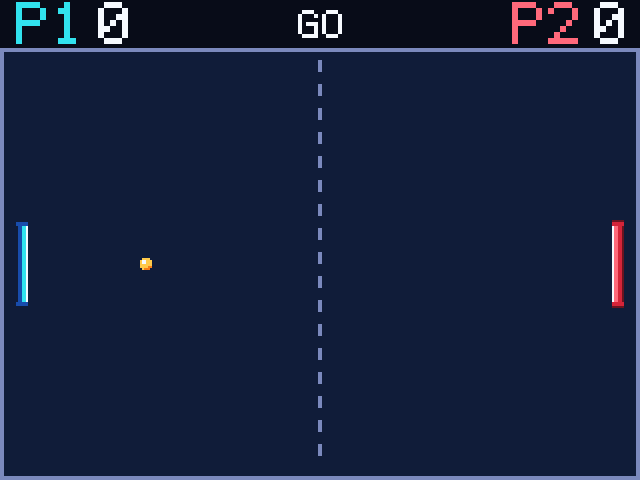

# Networking Pong

> **Demonstration project** — provided as an example of what the PixelRoot32
> Game Engine can do. It is not a product: parts may be incomplete,
> experimental, or deliberately simplified to keep one idea in focus.

Three boards and no router: an ESP32-2432S028 "Cheap Yellow Display" runs the
match, and two DFRobot Beetle ESP32-C3 boards are the controllers, each with a
128x64 OLED scoreboard. Everything travels over ESP-NOW on channel 6, which is
the single idea here — **one node owns the truth, two nodes send intent, and the
wire is sized so that ownership never needs to be negotiated.**

Language: C++17  
Engine: `gperez88/PixelRoot32-Game-Engine@^1.13.0`  
Environments: `native`, `esp32cyd_host`, `esp32c3_p1`, `esp32c3_p2`, `host_test`, `net_test`  
Category: Networking



## Requirements (build flags)

Networking is set once in [`lib/platformio.ini`](lib/platformio.ini)'s `[base]`
template; the rest of the budget belongs to the target, because a controller
that draws a scoreboard should not pay for a particle pool.

| Flag | Value | Why |
| ---- | ----- | --- |
| `PIXELROOT32_ENABLE_NETWORKING` | `1` | Compiles `NetSession`, the ESP-NOW backend and the loopback bus. Off by default, and this demo refuses to build without it (`#error` in [`PongHostScene.h`](src/PongHostScene.h)) rather than drawing a court with no link behind it. |
| `PIXELROOT32_ENABLE_4BPP_SPRITES` | *defined* on `native` / `esp32cyd_host` | The ball and both paddles are `Sprite4bpp`. The gate is `#ifdef`, so a bare define is the only spelling that turns the path on; `-D ...=0` would also enable it. Without it the actors fall back to filled rectangles. |
| `PIXELROOT32_ENABLE_AUDIO` | `1` host, `0` controllers | Six arcade cues on the CYD's DAC. The C3s are silent and have no backend. |
| `PIXELROOT32_ENABLE_PARTICLES` | `1` host, `0` controllers | Contact bursts and the goal spray. |
| `PIXELROOT32_ENABLE_CAMERA_EFFECTS` | `1` host | The screen shake on a contact. Nothing scrolls, so the camera exists only for the jolt. |
| `PIXELROOT32_ENABLE_PHYSICS` | `0` | The ball is integrated by the engine-free rules core; there is no solver to run. |
| `PIXELROOT32_ENABLE_UI_SYSTEM` | `0` | The HUD is `Renderer` text and rectangles; there is no widget tree to lay out. |
| `PIXELROOT32_USE_U8G2` | *defined* on both C3s | Selects `U8G2_Drawer` for the 1-bit SSD1306 panel instead of the TFT path. |
| `ESP_NOW_NODE_ID` | `2` or `3` | The application label of a controller. [`esp32_c3_controller.h`](src/platforms/esp32_c3_controller.h) rejects any other value with an `#error`, then re-checks the literal against [`NetConfig.h`](src/NetConfig.h) with a `static_assert`. |

Two display settings are easy to get wrong:

- **`esp32cyd_host` keeps `LOGICAL_WIDTH`/`LOGICAL_HEIGHT` unset.** The panel is
  mounted portrait (`PHYSICAL_*` 240x320), `DISPLAY_ROTATION=3` turns it into a
  320x240 canvas, and `DisplayConfig` swaps the logical pair for the quarter
  turn. Hand-setting 320x240 is swapped *back* to 240x320 and the scene loses its
  right-hand 80 px.
- **Both C3s set `LOGICAL_*` equal to `PHYSICAL_*` (128x64) with zero offsets**,
  so the scoreboard owns the whole framebuffer instead of a window inside it.

`host_test` deliberately does not extend `[base]`: it defines no networking flag
and ignores the engine library, which is what keeps the codec and the rules
compiling on a bare host.

## Platforms

| Environment | Board / display | Canvas | Audio | Input |
| ----------- | --------------- | ------ | ----- | ----- |
| **`native`** | SDL2 window, 640x480 client area (the 320x240 canvas at 2x) | 320x240 | `SDL2_AudioBackend`, 22050 Hz | Keyboard: `W`/`S` for P1, `↑`/`↓` for P2 |
| **`esp32cyd_host`** | ESP32-2432S028 "Cheap Yellow Display", **ILI9341_2** 240x320, `DISPLAY_ROTATION=3` | **320x240** | `ESP32_DAC_AudioBackend` on GPIO 26, 22050 Hz | none — both paddles arrive over ESP-NOW; the XPT2046 panel is left unclaimed |
| **`esp32c3_p1`** | DFRobot Beetle ESP32-C3, **SSD1306** 128x64 over U8G2 | 128x64 | none | GPIO 3 / GPIO 1 |
| **`esp32c3_p2`** | same board, same wiring | 128x64 | none | GPIO 3 / GPIO 1 |
| **`host_test`** | none — Unity over the engine-free layers | — | none | — |
| **`net_test`** | none — Unity over the real engine session and three loopback nodes | — | none | — |

`native` and `esp32cyd_host` compile the same host scene; only the transport,
the drawer and the audio backend differ. `esp32c3_p1` and `esp32c3_p2` compile
the same controller translation unit: `ESP_NOW_NODE_ID` is the whole difference,
and every optional subsystem is compiled out because a scoreboard needs none of
them.

## Controls

Each controller's two buttons move **its own** paddle and nothing else. There is
no shared input, no touch on the CYD, and no button that acts on the other
player.

| Input | `native` | ESP32-C3 | Moves |
| ----- | -------- | -------- | ----- |
| Up | `W` | GPIO 3 | that board's paddle towards the top of the court |
| Down | `S` | GPIO 1 | that board's paddle towards the bottom of the court |

On the C3 the two pins are wired to GND and `InputManager` applies
`INPUT_PULLUP` to every pin it is given, so no external resistors are needed. The
firmware names them `kLeftButtonPin` (3) and `kRightButtonPin` (1) because the
engine's `InputConfig` takes left/right; the court is vertical, so the rules read
those two bits as up/down.

Holding both buttons on one board cancels out. Releasing both leaves the paddle
where it is: only the held state travels, never a delta.

## The three roles

| Role | Environment | Node id | Paddle | Screen |
| ---- | ----------- | ------- | ------ | ------ |
| Host / authority | `esp32cyd_host` | `1` | both | court, HUD, overlay |
| Player 1 | `esp32c3_p1` | `2` | left | score, phase, own paddle bar |
| Player 2 | `esp32c3_p2` | `3` | right | score, phase, own paddle bar |

The ids are the wire contract: [`NetConfig.h`](src/NetConfig.h) is the only place
that names them, and the host maps `2` to slot 0 and `3` to slot 1 when the
session reports a peer joining under that node id. A board flashed with the
wrong environment still boots, but the host either ignores it (duplicate id) or
has a permanently still paddle (the other slot stays unbound). Reflash it; there
is no runtime switch.

## Hardware

**ESP32-2432S028 CYD** — the pin map is `games/chess`'s, unchanged:

| Signal | GPIO |
| ------ | ---- |
| Backlight (`TFT_BL`) | 21 |
| SPI MISO | 12 |
| SPI MOSI | 13 |
| SPI SCLK | 14 |
| Data/command (`TFT_DC`) | 2 |
| Reset (`TFT_RST`) | -1 (tied to the board's reset) |
| Chip select (`TFT_CS`) | 15 |
| DAC speaker | 26 |

**DFRobot Beetle ESP32-C3** — both controllers, identical wiring:

| Signal | GPIO |
| ------ | ---- |
| I2C SDA (SSD1306) | 5 |
| I2C SCL (SSD1306) | 6 |
| OLED reset | none (`255`) |
| Button, up | 3 (to GND) |
| Button, down | 1 (to GND) |

GPIO 26 is DAC2 and is where the speaker sits on the common 2432S028; board
revisions vary, and the internal DAC does not exist on the C3 at all, which is
why the controllers have no audio flag.

## What it demonstrates

**One authority, two intents.** The CYD owns the ball, both paddles, the score,
the phase and the serve; a controller sends one held-direction byte and paints
what it is told. That asymmetry is what makes a lossy radio harmless: a lost
`STATE` costs 33 ms of picture, and a lost `INPUT` means "keep doing what you
were doing", never "move by an amount that never arrived".

**A fixed match clock, not the frame clock.** The rules advance on a 60 Hz
accumulator with at most **3** catch-up steps per frame; a longer stall is
dropped rather than replayed, because the positions are stale by then and
replaying them would make the next frame late too. The host also clamps a frame
delta at 100 ms. A ~25 fps CYD and the uncapped simulator therefore move the ball
the same distance per second.

| Clock | Rate | What runs | Delivery |
| ----- | ---- | --------- | -------- |
| Rules step | 60 Hz fixed | ball, paddles, score, phase, serve | local |
| `STATE` fan-out | 30 Hz, per controller | 19-byte snapshot of the whole match | `Unreliable` |
| `INPUT` | on change + 250 ms keepalive | 5-byte held mask | `Unreliable` |
| Controller OLED | at most 10 Hz, change-gated | full 128x64 repaint (~23 ms over I2C) | local |
| Discrete events | on edge | `POINT`, `ROUND_START`, `PAUSE`, `MATCH_END`, `APP_HELLO` | `Reliable` |

**Unreliable for state, reliable for edges.** `STATE` is a full picture, so a
dropped frame costs one refresh and cannot accumulate drift. The reliable path
is the session's ACK-and-retry queue (8 pending frames, three retries), so
sending 30 frames a second on it would back the queue up and turn one lost ACK
into a stall. Everything discontinuous — a point, a serve direction, a pause, the
final score — must not be lost, so it is reliable and rare.

**Unicast fan-out.** `NetSession` has no broadcast send. The host walks its two
player slots, checks that the slot is bound and reachable, and sends to that
peer's `peerId`:

```text
player 0 -> bindings_[0].peerId
player 1 -> bindings_[1].peerId
```

Both controllers receive the **same** `STATE` sequence number, so the room can
compare the frame one board got with the frame the other got. `NetSession` is
4 peers / 64-byte payload by default; the largest frame here is 19 bytes, so
there is no fragmentation and no chunking anywhere in the demo.

**A controller reboot re-syncs instead of re-joining by hand.** A session starts
with a per-boot generation, so a rebooted C3 looks *new* to the host rather than
like a stale duplicate. On `PeerJoined` the host rebinds the same node id to its
slot, restarts that slot's anti-replay window, zeroes the paddle input, then
sends `APP_HELLO` **and** a reliable `STATE` immediately — waiting for the 30 Hz
tick would leave the panel showing a stale board for a third of a second. The
survivor sees `PAUSED` while the host's 1000 ms watchdog is unhappy, and the
match resumes into a fresh countdown as soon as both controllers are bound,
compatible and sending again. `MATCH_OVER` is never auto-resumed.

## The wire protocol

Hand-encoded little-endian bytes, tag first, in
[`src/net/PongProtocol.h`](src/net/PongProtocol.h). The structs are never cast
onto the wire: the host is an ESP32 and the controllers are ESP32-C3, and a cast
would depend on compiler padding and on the enum's underlying width agreeing
across both. Every decoder also checks the length against the exact size of its
message *before* reading a field, so a truncated or padded frame is rejected and
leaves the destination untouched.

| Tag | Message | Bytes | Delivery | Sent when |
| --- | ------- | ----- | -------- | --------- |
| 20 | `APP_HELLO` | 3 | Reliable | On every join, in both directions; carries version `1` and the sender's role |
| 21 | `INPUT` | 5 | Unreliable | Mask changed, or every 250 ms as a keepalive |
| 22 | `STATE` | 19 | Unreliable (Reliable on rejoin) | 30 Hz per controller, one sequence for both |
| 23 | `POINT` | 6 | Reliable | A rally ended; scorer and both scores |
| 24 | `ROUND_START` | 4 | Reliable | Before each serve; signed serve direction |
| 25 | `PAUSE` | 2 | Reliable | A peer was lost, or the match resumed |
| 26 | `MATCH_END` | 4 | Reliable | A side reached 5 |

`STATE` carries phase, ball position and velocity, both paddle centres, both
scores and a reserved flags byte. `seq` is the payload's own 16-bit counter and
wraps with the RFC 1982 comparison in `isNewerSequence()`: a frame that overtook
a newer one is dropped, and the half-open window (distance `0x8000`) is not an
ordering in either direction. The sequence lives in the payload because the
session's own `NetEvent::sequence` is `0` for unreliable frames.

`APP_HELLO` is a version gate, not a framework version: it changes only when a
layout changes. A peer reporting a different value is refused — the host pauses
the match rather than parsing its frames with the wrong field widths, and the
controller paints `V?`.

## Native simulator

`native` runs the **host plus both controllers in one window**, over a
`LoopbackBus`: one `Engine`, one host scene, three sessions and three
`LoopbackTransport`s with distinct synthetic MACs.

- **Auto-join.** The scene starts both simulated controllers immediately after
  the host session, exactly as two C3s would after the CYD, so the room reaches
  "both ready" on its own. Nothing is pressed to join: the `WAITING` panel is a
  status readout, not a screen you have to clear.
- **Keys.** `W`/`S` move P1 up/down; `↑`/`↓` move P2 up/down.
- **One Engine, one dispatcher.** The Engine pumps and dispatches only the host
  session; `PongHostScene::update()` pumps the two controller sessions itself
  (update, drain, firmware) on the same `millis()` it hands the bus. That is a
  simulation detail, not an engine limit: each real board runs its own Engine.
- The loopback is **lossless**, so it proves the protocol, the cadence, the
  rules and the drawing — not the RF behaviour.

While the match is `WAITING` or `PAUSED` the court is covered by the
diagnostics panel. Those are the two phases where nothing moves, and "why is
nothing moving" is exactly what it answers:

| Line | Example | Meaning |
| ---- | ------- | ------- |
| `NET CH n` | `NET CH 6` | The channel every node must share. "Same board, different channel" is the failure neither screen can otherwise show. |
| `P1 x   P2 y` | `P1 OK   P2 --` | Per slot: `OK` when the peer is bound, online **and** speaking this build's protocol version; `--` otherwise. |
| `RTT n MS` | `RTT 0 MS` | Milliseconds of the last ACKed reliable frame. It reads `0` before the first ACK, and it can read `0` on the loopback when a frame is acknowledged inside the same pump; once a point crosses a frame boundary it shows the real round trip. |
| `DROP n` | `DROP 0` | Frames the session had to drop from its receive queue. The contract is **zero**: the cadence is sized so the queue never overflows. A rising value is a bug, not weather. |
| `QUEUE n` | `QUEUE 0` | Reliable frames still waiting for an ACK. Briefly non-zero after a join or a goal; staying at capacity means the link is gone. |

## Art pipeline

The sprites are generated, never hand-edited. `tools/art_source.py` holds the
character grids and the 16-slot palette; [`tools/generate_sprites.py`](tools/generate_sprites.py)
packages them into [`src/assets/PongPalette.h`](src/assets/PongPalette.h) and
[`src/assets/PongSprites.h`](src/assets/PongSprites.h). Standard library only —
no Pillow, no PlatformIO.

```bash
python tools/generate_sprites.py            # write both headers
python tools/generate_sprites.py --check    # re-render in memory, fail if stale
python tools/generate_sprites.py --preview  # 6x contact sheet, tools/sprite_preview.png
```

`--check` writes nothing and exits non-zero on a stale header, so a hand-edited
grid fails before it ships. `--preview` paints each sprite over the court ink and
shows transparent pixels in magenta. The sheet is gitignored: `tools/*.png` never
enters a commit.

A `Sprite4bpp` cannot be scaled at draw time, so every sprite is emitted at the
exact rectangle the court clips it into — ball 6x6, paddle 6x44 per player — and
[`CourtRenderer.h`](src/presentation/CourtRenderer.h) `static_assert`s those sizes
against the rules geometry, so art and collision cannot drift apart.

Palette roles, in slot order (16 slots, all assigned):

| Slots | Role |
| ----- | ---- |
| 0 | Court ink. Must never be `0x0000`: `Color::Black` is index 0 and that word is the 8bpp framebuffer's transparent pixel, which would erase every black primitive. The generated header `static_assert`s it. |
| 1-2 | Arcade white (ball specular, paddle edge, scores) and court navy (playfield, P1 cap) |
| 3-5 | P1 blue, P1 cyan, deep teal |
| 6-7 | Arcade green and pale mint: spare cool footer inks, unused today (the diagnostics panel draws in white) |
| 8-9 | Ball gold and ember — also the particle fade pair |
| 10-12 | P2 rose, P2 red, P2 maroon |
| 13-15 | Violet and magenta (spares) and slate, which draws the court frame, the dashed centre line and dim text |

## Effects and sound

| Event | Sound | Particles | Shake |
| ----- | ----- | --------- | ----- |
| Paddle contact | 660 Hz pulse, 40 ms, 50% duty | **8** | 2 px, 100 ms |
| Wall bounce | 330 Hz triangle, 30 ms | **4** | 1.5 px, 70 ms |
| Goal | pulse falling 440 -> 110 Hz, 250 ms, exponential | **24** | 3.5 px, 200 ms |
| Countdown | 880 Hz pulse, 60 ms, 25% duty | — | — |
| Pause / resume | 220 Hz triangle, 80 ms | — | — |
| Match point | C5-E5-G5 arpeggio, 360 ms | — | 5 px, 320 ms |

The wall is a secondary contact, so it sits under the paddle cue instead of
competing with it; the goal's exponential sweep is the one sound in a rally that
should feel final. One 50-particle emitter serves every event (the burst origin
is a parameter), and it is stepped at a fixed **25 Hz** rather than once per
frame: the emitter ages a particle by one step per call, so a per-frame step
would burn a burst in a fraction of a second on the uncapped native loop while
stretching it past a second on the CYD.

Both particle colours stay high-luminance on purpose. `ParticlePresets::Explosion`
and `::Smoke` are unused because both end on `Color::Black`, which is RGB565
`0x0000` — transparent on the ESP32, correct-looking under SDL2.

The cues live in [`src/presentation/PongSfx.cpp`](src/presentation/PongSfx.cpp)
behind the same no-op shim pattern the other demos use: `playSfx()` is declared
once, and with `PIXELROOT32_ENABLE_AUDIO=0` it compiles to an empty function, so
no call site in the scene is guarded.

## Host tests

```bash
pio test -e host_test
pio test -e net_test
```

Two environments, two postures, one set of test files under `test/`:

- **`host_test` — 55 cases, no engine.** `lib_ignore` removes the engine library
  and `build_src_filter = +<net/> +<game/>` names exactly the dependency-free
  directories, so the suite needs no display, no SDL2 and no radio. It covers
  the wire codec (`test_protocol`: every field of every tag, the exact byte
  vectors, malformed-length rejection, capacity probing, sequence wrap),
  the match simulation (`test_rules`: fixed-step movement, bounce geometry,
  scoring, phase timers, event ring), and the engine-free halves of the
  controller and host adapters.
- **`net_test` — 70 cases, the real engine.** It extends `[env:native]`, so
  `NetSession`, `LoopbackTransport` and the ESP-NOW-facing code compile as the
  firmware compiles them, and the extra cases drive **three real sessions** over
  a loopback bus: join and expected-node binding, unicast fan-out with one
  sequence, per-board paddle isolation, stale-sequence rejection, version
  refusal, reliable goal/serve reporting, peer-loss pause, and the controller
  reboot resync.

Both suites are listed in the hand-maintained matrix in
[`.github/workflows/build.yml`](../../.github/workflows/build.yml); a `*_test`
environment nobody lists is a suite CI never runs.

## How this differs from `games/pong`

This is an independent implementation, not a port. It shares no file, no type
and no namespace with `games/pong` (this one lives in `netpong`), and
`games/pong` is not modified.

- **Network-authoritative instead of local.** `games/pong` reads a local input
  device, drives a CPU right paddle and serves on `rand()`. Here no node holds
  input for both players: the host is the only writer of the ball, the score and
  the phase, and the right paddle is a second board on the radio.
- **No physics module.** `games/pong` leans on the engine's physics; this demo
  integrates Q8.8 fixed point in an engine-free `src/game/PongRules` so the host
  and the CYD produce byte-identical arithmetic.
- **A real test surface.** `games/pong` has no `test/` directory. Here the codec
  and the rules are host-testable by construction, and the three-node behaviour
  is covered by a loopback suite.
- **Two screens, not one.** The controllers own their panels; the host owns the
  court. Nothing mirrors the CYD's framebuffer over the wire.

## Troubleshooting

### Both slot tokens stay `--` and the match never starts

Nothing is joining. Check, in this order: all three boards are running this demo;
all three use channel 6; no board is associated to a router (an AP can move the
radio off the channel and drop the link); the controllers are within radio range.

### One token is `OK` and the other is `--`

Only one controller is bound. The usual causes are a controller flashed with the
wrong environment (both boards claiming node 2 or both claiming node 3) or a
board that is on a different channel.

### Both C3s were flashed with the same environment

The host keeps the **first** peer that claims a node id and ignores the second,
which stays unbound forever. The symptom is one `OK`, one `--`, and one paddle
that never moves. Reflash one board with `esp32c3_p2` (`ESP_NOW_NODE_ID=3`). A
duplicate does not disturb a match already in progress — the late peer is simply
never addressed.

### A controller shows `WAIT`

`WAIT` means the host has not sent it a `STATE` yet: it has not joined, the host
is not running, or the channel differs. The line beside it tells you which: `NO
LNK` means the 1500 ms host watchdog has expired, `V?` means the host answered
with a protocol version this build cannot parse. Both are link or firmware
problems, not gameplay.

### `DROP` is rising

The host's receive queue overflowed. The demo's contract is zero drops, and the
cadences exist to keep it there, so a non-zero counter means something else is
saturating the radio (another demo on channel 6) or a board is retrying far more
than the queue can take. It is not normal traffic.

### A controller reboots mid-rally

Expected transient: the survivor sees `PAUSED`, the overlay shows the
diagnostics panel, and the match resumes into a fresh countdown once the rebooted
board has handshaked and sent input again. The rebooted board's score comes back
from the immediate reliable `STATE`, not from local storage.

### The match ends and stays on `OVER`

`MATCH_OVER` is terminal in this build (see [Limitations](#limitations)). Restart
the host to play another set. The `P1 WINS` / `P2 WINS` result stays correct in
the meantime, and a controller cannot restart it.

## Limitations

- **No encryption.** The session registers peers unencrypted. Anyone in radio
  range can observe or inject frames, and a forged `INPUT` would move a paddle.
- **No node-id collision detection.** Two boards claiming the same id are not
  reported; the host silently keeps the first claimant and ignores the second,
  so the failure looks like a dead paddle, not like a configuration error.
- **The channel is fixed at compile time** (`kChannel = 6` in
  [`NetConfig.h`](src/NetConfig.h)). There is no runtime selector, and all three
  boards must be rebuilt if it ever changes.
- **No rematch from the controllers.** `Rules::restart()` exists and is tested,
  but no input path in the firmware calls it, so the match stops at 5 and the
  host must be restarted for another set.
- **Two players only.** A third peer may associate with the radio, but the host
  binds only node ids 2 and 3 and ignores everything else.

## Project layout

```text
networking/pong/
├── platformio.ini          # native, esp32cyd_host, esp32c3_p1, esp32c3_p2, host_test, net_test
├── lib/platformio.ini      # [base] / [base_esp32] / [base_native] templates
├── screenshots/            # screenshot.png — the native client area
├── tools/
│   ├── art_source.py       # character grids and the 16-slot palette — the editable original
│   └── generate_sprites.py # the 4bpp generator (--check, --preview)
├── src/
│   ├── NetConfig.h         # channel, the three node ids, the cadence contract
│   ├── main.cpp            # target dispatch — exactly one platform header
│   ├── game/
│   │   └── PongRules.h/.cpp    engine-free Q8.8 match simulation
│   ├── net/
│   │   ├── PongProtocol.h/.cpp hand-encoded wire codec
│   │   ├── PongHost.h/.cpp     host authority: binding, 60 Hz step, 30 Hz fan-out
│   │   └── PongController.h/.cpp controller: INPUT cadence, prediction, watchdog
│   ├── presentation/
│   │   ├── CourtRenderer.h/.cpp  court, HUD, diagnostics panel, palette
│   │   ├── CourtLayout.h         design box, viewport offset, band geometry
│   │   ├── ControllerScreen.h/.cpp the 128x64 scoreboard and its redraw key
│   │   ├── PongEffects.h/.cpp    one emitter, one shake
│   │   └── PongSfx.h/.cpp        the six cues behind the audio shim
│   ├── PongHostScene.h/.cpp      host composition root (CYD and native)
│   ├── PongControllerScene.h/.cpp controller composition root (both C3s)
│   ├── assets/                   GENERATED — PongPalette.h, PongSprites.h
│   └── platforms/                native.h, esp32_cyd.h, esp32_c3_controller.h
└── test/
    ├── test_protocol/          wire vectors, malformed frames, sequence wrap
    ├── test_rules/             movement, collisions, scoring, phase timers
    ├── test_controller/        INPUT cadence, prediction, watchdog, screen key
    └── test_host_session/      binding, fan-out, pause, reboot resync (engine on)
```

## Engine documentation

- [Networking guide](https://docs.pixelroot32.org/guide/networking)
- [Networking subsystem](https://docs.pixelroot32.org/architecture/networking-subsystem)
- [Core API](https://docs.pixelroot32.org/api/core)
- [Graphics / Renderer](https://docs.pixelroot32.org/api/graphics)
- [Audio API](https://docs.pixelroot32.org/api/audio)
- [Examples catalogue](https://docs.pixelroot32.org/examples/demos)

## Build

From **`networking/pong`**:

```bash
pio run -e native            # SDL2 simulator: host + both controllers in one window
pio run -e esp32cyd_host     # CYD host firmware
pio run -e esp32c3_p1        # controller, ESP_NOW_NODE_ID=2
pio run -e esp32c3_p2        # controller, ESP_NOW_NODE_ID=3
```

PlatformIO fetches the engine itself (`^1.13.0`, which pulls `PixelRoot32-APU`
2.0.0 for the audio core), so no local engine checkout is needed. The native
build needs SDL2: from MSYS2/MinGW on Windows,
`libsdl2-dev` on Linux, `brew install sdl2` on macOS. The `[env:native]` flags
here ship with the Windows/MSYS2 include and library paths; remove the
`-IC:/msys64/...`, `-LC:/msys64/...` and `-mconsole` flags on the other two, and
uncomment the Homebrew lines next to them.

```bash
pio run -e native --target exec     # build and run the simulator
```

## Upload (ESP32)

List the boards first — with three attached, the ports are three different
entries:

```bash
pio device list
```

Then flash one target per board, naming the port explicitly:

```bash
pio run -e esp32cyd_host --target upload --upload-port COM4
pio run -e esp32c3_p1    --target upload --upload-port COM5
pio run -e esp32c3_p2    --target upload --upload-port COM6
```

On Linux/macOS use the device paths instead (`/dev/ttyUSB0`, `/dev/ttyACM0`).
With only one board attached, omit `--upload-port` and let PlatformIO pick it.
The order does not matter: whoever boots last joins the room, and the host
re-syncs the newcomer from its own authoritative state.

## License

Source code: [MIT](../../LICENSE).

| Asset | Author | License | Source |
| ----- | ------ | ------- | ------ |
| Ball arcade sprites (6x6, two paddles at 6x44) | This repository | CC0 1.0 (public domain) | Original work, drawn as character grids in [`tools/art_source.py`](tools/art_source.py) and emitted by [`tools/generate_sprites.py`](tools/generate_sprites.py) into `src/assets/` |
| Six arcade cues | This repository | CC0 1.0 (public domain) | Original work, synthesised at runtime from `AudioEvent` definitions in [`src/presentation/PongSfx.cpp`](src/presentation/PongSfx.cpp) |

The art is a three-sprite cast, drawn for this demo and released with it. The
generated headers in `src/assets/` are the shipped artefact: edit the grids in
`tools/art_source.py` and re-run the generator, then `--check` to prove the
headers still match. The sound is a set of `SfxBreakpoint` and `AudioEvent`
values, so there is no audio file to attribute.
